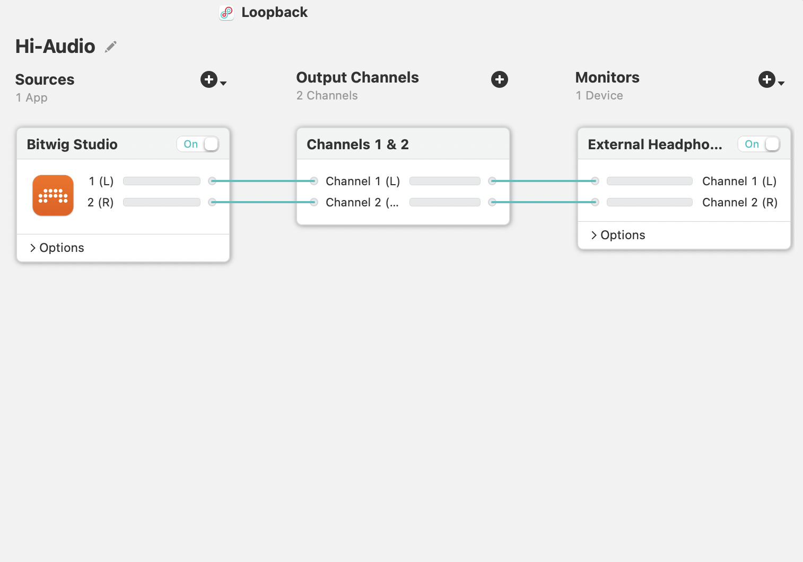
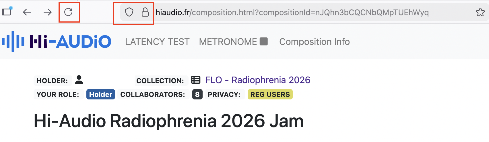
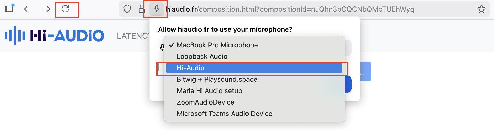
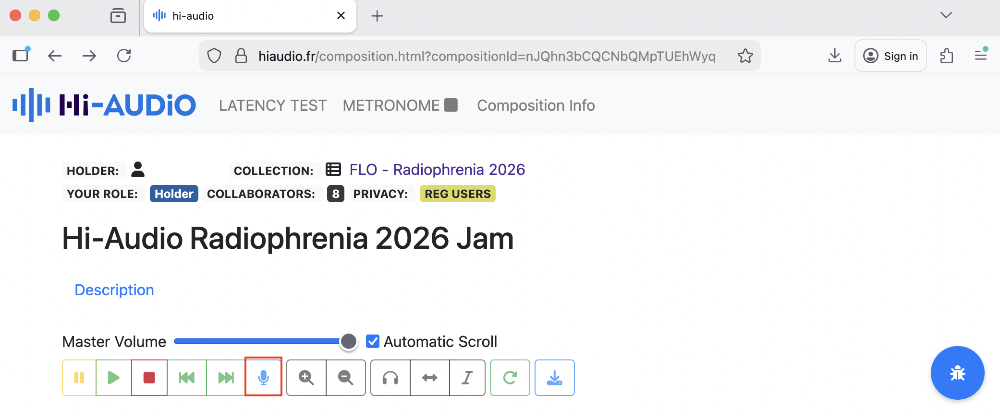
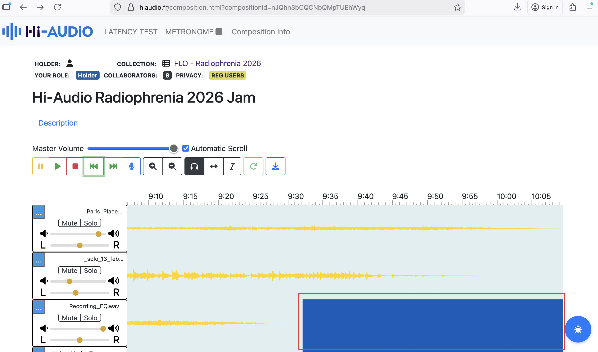
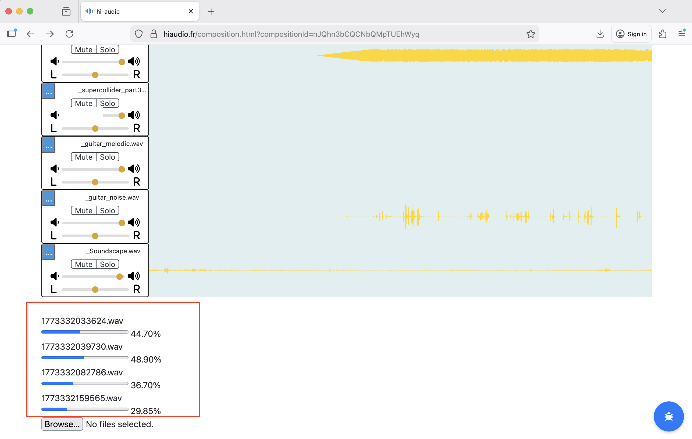
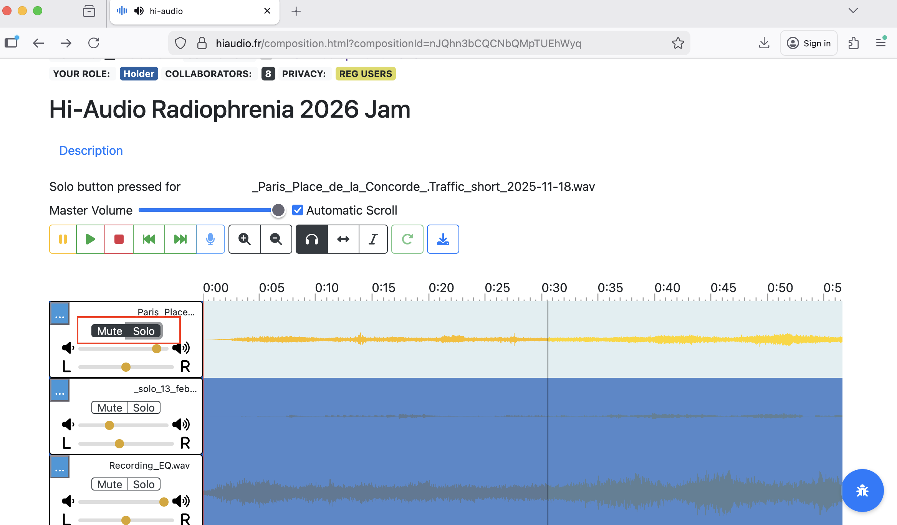
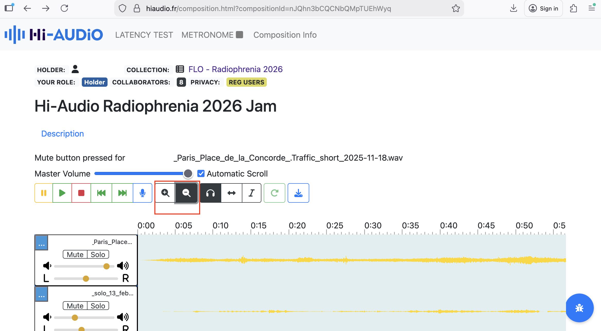

# Hi-AUDiO: Practice-Based Evaluation Report

**Project / Platform:** Hi-AUDiO / [hiaudio.fr](https://hiaudio.fr)  
**Client / Lab:** Télécom Paris  
**Evaluator:** Nela Brown  
**Role:** Director, FLO Lab  
**Evaluation Period:** 13/02/2026 – 13/03/2026  
**Document Date:** 22 March 2026  
**Last Revised:** 21 August 2026 — see `CONTEXT.md` for the revision history

---

## Repository Contents

This repository publishes the practice-based evaluation report (this file), the participant survey that complements it including pseudonymised response data, and the analysis of those survey responses. The table below lists everything published in the repository.

| Category | File / Folder | What it is |
|---|---|---|
| Report | `README.md` | This file — the practice-based evaluation report itself |
| Report | [`docs/Practice-Based Evaluation of the Hi-AUDiO platform by FLO Lab .pdf`](./docs/Practice-Based%20Evaluation%20of%20the%20Hi-AUDiO%20platform%20by%20FLO%20Lab%20.pdf) | The original evaluation memo, as a PDF — **historical; superseded by this report** where the two differ (it predates the onboarding, timeline and funding-statement corrections recorded in `CONTEXT.md`) |
| Report | [`docs/output.md`](./docs/output.md) | Historical record: the original Pandoc conversion of the memo from `.docx` — content preserved as-is, except for 8 relative image paths updated when the file was relocated into `docs/`. Where it differs from this report, **this report supersedes it** — notably its description of the onboarding sessions, since clarified in §3 |
| Report | [`CITATION.cff`](CITATION.cff) | Structured citation metadata (also powers GitHub's "Cite this repository" button) |
| Survey instrument | [`docs/participant_survey.md`](./docs/participant_survey.md) | The participant questionnaire, as administered via JotForm (23 questions, three sections) |
| Survey instrument | [`docs/ANALYSIS_PLAN.md`](./docs/ANALYSIS_PLAN.md) | The planned approach for analysing survey responses: quantitative and thematic-coding methodology, triangulation against this report |
| Response data | [`docs/participant_survey_responses.csv`](./docs/participant_survey_responses.csv) / [`.xlsx`](./docs/participant_survey_responses.xlsx) | Pseudonymised respondent-level responses from all 9 participants, one row per respondent. Rows carry a submission date, not a participant ID; use `docs/response_id_mapping.md` to link a row to its P01–P09 identifier |
| Response data | [`docs/individual_participant_responses/`](https://github.com/idsinge/hiaudio_FLO_practice-based_evaluation/tree/main/docs/individual_participant_responses) | Per-respondent submission exports (`P01.pdf`–`P09.pdf`), pseudonymised by participant ID |
| Response data | [`docs/response_id_mapping.md`](./docs/response_id_mapping.md) | Maps each participant ID (P01–P09) to its original JotForm submission identifier, for cross-referencing the CSV/XLSX rows against the individual PDFs |
| Survey analysis | [`docs/figures/`](https://github.com/idsinge/hiaudio_FLO_practice-based_evaluation/tree/main/docs/figures) | The three figures used in the analysis (SVG), plus `make_figures.py`, which regenerates them from the published CSV so they can be verified against the data |
| Survey analysis | [`docs/analysis_summary_print.html`](./docs/analysis_summary_print.html) / [`docs/make_print_html.py`](./docs/make_print_html.py) | A print/PDF rendering of the analysis, and the script that regenerates it from the Markdown so the two cannot drift apart |
| Survey analysis | [`docs/analysis_summary.md`](./docs/analysis_summary.md) | Analysis of the survey responses: sample description, quantitative results for Q16–Q20, thematic coding of the open questions, and triangulation against §4–§8 of this report — including a sensitivity analysis excluding the respondent identified in the Positionality note below |
| Supporting | [`docs/REFERENCES.md`](./docs/REFERENCES.md) | Full annotated reference list for the sources cited in this report and in the analysis plan |
| Supporting | [`CONTEXT.md`](CONTEXT.md) | Project background and working notes for collaborators |
| Supporting | [`AGENTS.md`](AGENTS.md) / [`CLAUDE.md`](CLAUDE.md) | Working instructions for AI coding assistants and collaborators working in this repository |
| Supporting | `images/` | Screenshots and figures referenced throughout this report |
| Supporting | [`LICENSE`](LICENSE) | CC BY 4.0 — covers everything **except** the participant response data |
| Supporting | [`docs/DATA_LICENSE.md`](./docs/DATA_LICENSE.md) | Research-use licence governing the participant response data (CSV/XLSX, individual PDFs, ID mapping) |
| Supporting | [`_config.yml`](https://github.com/idsinge/hiaudio_FLO_practice-based_evaluation/blob/main/_config.yml) | Jekyll theme configuration for GitHub Pages (Jekyll does not copy underscore-prefixed files into the published site, so this link points at the repository) |

All response data was screened for personally identifiable information before publication; see the "Positionality note" in §3 below for the one disclosed exception (a participant who is also a co-designer of the questionnaire).

The response data is **pseudonymised rather than anonymised**: each row is one respondent, carrying a submission date that links to a stable participant identifier through `docs/response_id_mapping.md`. Because the cohort is small and FLO's membership is public, readers should treat these records as potentially re-identifiable and use them accordingly.

**Licensing is split.** The report, survey instrument, analysis, and images are licensed [CC BY 4.0](LICENSE). The participant response data — the CSV/XLSX, the individual respondent PDFs, and the ID mapping — is released under a more restrictive [research-use licence](./docs/DATA_LICENSE.md) reflecting the terms on which participants gave consent: non-commercial academic research and educational use only, no redistribution, and no attempted re-identification.

---

## Table of Contents

- [Repository Contents](#repository-contents)
- [Summary](#summary)
- [1. Purpose of This Memo](#1-purpose-of-this-memo)
- [2. Evaluation Context](#2-evaluation-context)
  - [2.1 User Profile](#21-user-profile)
  - [2.2 Use Case](#22-use-case)
  - [2.3 Scope](#23-scope)
- [3. Methodological Approach](#3-methodological-approach)
- [4. Platform Strengths](#4-platform-strengths)
  - [4.1 Accessibility](#41-accessibility)
  - [4.2 Ease of Use](#42-ease-of-use)
  - [4.3 Interface Discoverability](#43-interface-discoverability)
  - [4.4 Track Annotation](#44-track-annotation)
- [5. Observed Workflow Challenges](#5-observed-workflow-challenges)
  - [5.1 Visual Feedback and Interface Clarity](#51-visual-feedback-and-interface-clarity)
  - [5.2 Transport Controls and Navigation](#52-transport-controls-and-navigation)
  - [5.3 Recording Workflow Limitations](#53-recording-workflow-limitations)
  - [5.4 Editing and Audio Manipulation](#54-editing-and-audio-manipulation)
  - [5.5 Timeline Manipulation](#55-timeline-manipulation)
  - [5.6 Signal Flow and Rendering Stability](#56-signal-flow-and-rendering-stability)
  - [5.7 Interaction Design and Gestural Support](#57-interaction-design-and-gestural-support)
  - [5.8 File Interoperability](#58-file-interoperability)
  - [5.9 Track Management](#59-track-management)
- [6. Design Implications and Opportunities](#6-design-implications-and-opportunities)
- [7. Assessment of Platform Fit for Professional Creative Workflows](#7-assessment-of-platform-fit-for-professional-creative-workflows)
- [8. Key Findings and Next Steps](#8-key-findings-and-next-steps)
  - [8.1 Key Findings](#81-key-findings)
  - [8.2 Potential for Future Collaboration](#82-potential-for-future-collaboration)
- [Appendix A: Introduction, Onboarding, and Evaluation Timeline](#appendix-a-introduction-onboarding-and-evaluation-timeline)
- [Appendix B: Platform Use and Interface Observations](#appendix-b-platform-use-and-interface-observations)
- [References](#references)
- [Citation](#citation)
- [9. Acknowledgements](#9-acknowledgements)

---

## Summary

This memo outlines findings from a practice-based evaluation of the Hi-Audio platform, conducted by nine performers from the [Female Laptop Orchestra (FLO)](https://femalelaptoporchestra.org/). The evaluation took place between February 13, 2026, and March 13, 2026, during the production of a collaborative composition intended for the Radiophrenia 2026 festival broadcast. While the platform demonstrated strong accessibility and ease of onboarding through its browser-based design, several workflow limitations were identified when used in a professional context. The observations presented below translate participant feedback into design considerations that may inform future development of the platform. The platform itself is described in Gil Panal, David and Richard (2026). A complementary task-based usability study of the Hi-Audio platform, conducted with 22 participants using the System Usability Scale (SUS; Brooke, 1996) and NASA-TLX (Hart & Staveland, 1988), is available at [hiaudio_user_evaluation_results](https://github.com/idsinge/hiaudio_user_evaluation_results).

## 1. Purpose of This Memo

The purpose of this memo is to present findings from a practice-based expert evaluation of the Hi-Audio platform conducted through artistic use rather than task-based usability testing. The original evaluation memo is available in [PDF format](./docs/Practice-Based%20Evaluation%20of%20the%20Hi-AUDiO%20platform%20by%20FLO%20Lab%20.pdf). The goal of the evaluation was to assess the platform's suitability for real-world creative workflows, identify strengths and limitations and highlight design considerations relevant to advanced users and artistic contexts. By synthesising qualitative feedback gathered through the evaluation process, the memo identifies workflow bottlenecks and outlines considerations that may inform future platform development and research dissemination.

## 2. Evaluation Context

### 2.1 User Profile

The evaluation was conducted by nine members of the Female Laptop Orchestra (FLO), including the FLO Lab director listed above as the 'Evaluator'. [Female Laptop Orchestra (FLO)](https://femalelaptoporchestra.org/) is an internationally distributed ensemble that regularly incorporates emerging technologies into compositions, recordings, and performances. Within this ecosystem, [FLO Lab](https://femalelaptoporchestra.org/flo-lab/) operates as a practice-based research initiative where new audiovisual tools are tested and evaluated from both artistic and technical perspectives.

Most FLO members hold academic positions in music, sound, HCI, and related fields, along with extensive experience in the use of professional Digital Audio Workstations (DAWs) and experimental research-stage Web Audio platforms in Networked Music Performance (NMP). This positions FLO, and by extension FLO Lab, as a research-literate group of expert practitioners capable of adapting to diverse creative and technical workflows without formal training.

### 2.2 Use Case

In this evaluation, the Hi-Audio platform was used for remote asynchronous recording of 16 audio tracks by FLO members based in Australia, Brazil, Croatia, France, Italy, Poland, Slovakia, Spain and the UK. The recordings were intended as source material for a collaborative composition that would later be mixed offline and submitted to the Radiophrenia 2026 festival.

Individual recording sessions involved the use of acoustic and electronic instruments, percussion, vocals (utilising audio interfaces and Loopback software for internal audio routing to Firefox), as well as live coding and binaural soundscape recordings.

The workflow also involved downloading recordings from the Hi-Audio platform, converting and importing them into performers' Digital Audio Workstations (DAWs) for additional DSP processing using audio plug-ins and AI-based tools. The processed material was subsequently uploaded back to the platform.

As the resulting composition is intended for broadcast at a professional music festival, the project also provides a potential dissemination context for the Hi-Audio platform and the associated research project initiative.

### 2.3 Scope

The evaluation focused on the recording interface, transport controls, visual feedback, file management, creative flow and suitability for professional contexts.

## 3. Methodological Approach

Seven FLO members, including the FLO Lab director, were onboarded to the Hi-Audio platform by the Lead Software Engineer: the director in an initial session, and six further members across two separate two-hour sessions. Two additional FLO members were onboarded by the FLO Lab director, who also coordinated the recording process, organised scheduling, assisted with troubleshooting, and collected participant feedback throughout the evaluation period. The onboarding sessions introduced the platform interface, conducted latency tests, and examined signal flow across different recording configurations.

Following onboarding, the FLO Lab director created a private Collection titled *"FLO - Radiophrenia 2026"* and a Composition within that Collection titled "Hi-Audio Radiophrenia 2026 Jam."

The remaining eight performers were invited as members using the Composition Info section, which generated automated email invitations from the Hi-Audio platform. Upon registration, participants were able to navigate directly to the shared recording session workspace.

All participant contribution tracks were recorded and uploaded between February 13, 2026, and March 3, 2026. The guide track — a pre-existing binaural soundscape used as a timing reference — was uploaded earlier, on January 30, 2026, as noted in the Appendix. The mixing phase took place between March 3 and March 13, 2026. A detailed recording timeline is provided in the Appendix.

The FLO Lab evaluation approach prioritises ecological validity (Schmuckler, 2001). Rather than relying on controlled usability tasks, the evaluation followed a practice-based research methodology (Candy, 2006) grounded in real creative activity. Insights were generated through hands-on use of the platform during individual recording sessions, reflecting observations during and after these sessions, and informal comparison with existing tools and workflows.

Communication between participants took place through a dedicated WhatsApp group created specifically for the testing period, ensuring that discussions related to the Hi-Audio platform did not overlap with other FLO projects. WhatsApp was chosen over email to enable rapid communication and troubleshooting during recording sessions. Issues encountered by performers were addressed either directly by the FLO Lab director or communicated to the Lead Software Engineer where necessary.

The collected material included notes taken during onboarding and recording sessions, informal feedback regarding technical issues encountered during the creative process (such as signal-flow challenges or interface inconsistencies), and suggestions for platform improvement.

To complement these qualitative findings, a structured participant questionnaire was administered to FLO members following the evaluation period. The questionnaire was assembled for this study from items drawn from the technology acceptance literature, covering technical setup, first-time usability, hedonic experience, and future use intent. Specifically: **Q18** uses the four-item Perceived Ease of Use scale and **Q19** the three-item Perceived Enjoyment scale, both as worded in Venkatesh (2000, Appendix 1) — themselves adapted there from Davis (1989) and Davis, Bagozzi and Warshaw (1992) respectively — with the verb tense changed from present to past ("I find…" → "I found…") and the platform named in place of "the system." **Q20_2** is Davis's (1989) perceived-usefulness item with the domain changed from "in my job" to "for recording music"; **Q20_1** and **Q20_3** are attitude and behavioural-intention items in the same tradition, but their direct wording source has not been established and none is claimed here; **Q20_4** is a recommendation item that is not part of any of these scales. **Q16** and **Q17** are single items written for this study.

The instrument as a whole is therefore **not** a single standardised questionnaire, and it was not re-validated for this population. Its ratings are reported descriptively and should not be compared against published norms for any of the source scales, nor treated as validated subscale scores: the items were recombined across sources, and the sample (n = 9) is far too small to establish reliability. A further difference from the source scales is one of framing rather than wording — they were written to be answered about a system in current use, whereas this questionnaire was answered months after the evaluation period ended. Its verbal anchors follow the fully labelled seven-point form discussed by Rohrmann (2007) and Preston and Colman (2000). Results are reported in [`docs/analysis_summary.md`](./docs/analysis_summary.md).

**Positionality note:** the participant questionnaire was designed collaboratively by the FLO Lab director and the Hi-AUDiO Lead Software Engineer. Two aspects of that arrangement are disclosed here for transparency.

First, the FLO Lab director — who co-designed the questionnaire and authored this evaluation memo — also completed the questionnaire as one of the nine respondents (participant P09 in the published response data). Her response is retained in the dataset rather than excluded, consistent with the practice-based, practitioner-embedded nature of this evaluation (Brannick & Coghlan, 2007; Berger, 2015), but readers should account for it when weighing the objectivity of aggregate results. One consequence of this disclosed dual role: her name appears once in the response data itself, in a track filename she references in her own answer — left unredacted, since she is already named as this report's author and evaluator above.

Second, the Lead Software Engineer is a member of the Hi-AUDiO team that develops the platform under evaluation, so the questionnaire was co-designed in part by the platform's own development side. They did not complete the questionnaire and are not among the nine respondents. This is disclosed so that readers can weigh it: the questionnaire as administered, the full pseudonymised response data, and the analysis of those responses are all published in this repository and can be examined independently.

The following sections summarise the key insights derived from the practice-based evaluation material.

## 4. Platform Strengths

This section highlights aspects of the Hi-Audio platform that effectively supported the collaborative workflow used by FLO members during the evaluation.

### 4.1 Accessibility

The browser-based architecture was identified as a major strength. Participants noted that the ability to access the recording environment without installing dedicated software significantly lowers the barrier to entry for geographically distributed collaborators and supports cross-platform participation.

### 4.2 Ease of Use

Despite the early-stage nature of the platform, the core recording interface was described by several FLO members as *"simple and easy to use"* for basic recording tasks. This simplicity contributed positively to the onboarding process and allowed performers to begin recording relatively quickly.

### 4.3 Interface Discoverability

Hover-over labels for interface buttons (e.g., the Stop control) were noted as helpful in supporting initial orientation within the platform. These small interface cues helped compensate for the absence of some familiar DAW conventions.

### 4.4 Track Annotation

The ability to attach notes and annotations to individual tracks supported communication between geographically distributed performers. Participants found this feature particularly useful when explaining recording conditions, signal chains, or artistic intentions associated with individual contributions.

## 5. Observed Workflow Challenges

This section summarises workflow limitations encountered during the evaluation. The observations reflect issues that became visible during real creative use of the platform rather than controlled usability testing.

### 5.1 Visual Feedback and Interface Clarity

Several interface elements lacked clear state-change indicators, which occasionally caused uncertainty during recording sessions.

For example, the Mute and Solo buttons did not provide sufficiently visible confirmation when active. Similarly, the microphone icon used to initiate recording differed from the conventional "record" symbol familiar to most Digital Audio Workstation (DAW) users. Because FLO members were typically recording through external audio interfaces rather than internal microphones, this icon initially caused confusion regarding its function.

In addition, the visual change indicating that recording had started was extremely subtle. In practice, the transport bar appeared slightly lighter after activation; however, this change was difficult to perceive on many displays and in many lighting conditions, making it unclear whether recording had begun.

Some performers also noted that dark-blue waveform segments representing silence could be mistaken for inactive or missing audio.

### 5.2 Transport Controls and Navigation

Participants reported several missing features commonly found in professional audio software that affected workflow efficiency.

The absence of standard keyboard shortcuts—most notably the Spacebar for Play/Stop—was reported as slowing down recording sessions because performers needed to move the cursor repeatedly between recording areas and the transport bar.

Fast Forward and Rewind controls also appeared to jump directly to the beginning or end of the timeline rather than moving incrementally through the recording. This behaviour differed from typical DAW navigation patterns.

Zoom controls were described as somewhat unresponsive, and the function of the headphones icon (Select Cursor) was not immediately clear to some participants.

### 5.3 Recording Workflow Limitations

Several limitations affected the flexibility of the recording process.

Participants noted the absence of a pause-and-continue recording option, which would allow performers to temporarily stop recording while maintaining continuity within a single track. Such functionality is widely used in iterative recording workflows.

The platform also lacked visible input gain control, which was described as critical when working with external recording chains.

### 5.4 Editing and Audio Manipulation

Participants identified the absence of basic non-destructive editing tools as a major limitation.

Common operations such as cutting, trimming, or pasting audio regions—normally performed through shortcuts such as Cmd/Ctrl+C and Cmd/Ctrl+V—were not supported. As a result, several editing tasks had to be deferred to external Digital Audio Workstations during the final mixing stage.

Similarly, the lack of volume automation or envelope control made it difficult to manage the dynamic balance between tracks or perform basic crossfades directly within the platform.

### 5.5 Timeline Manipulation

The "Shift Audio in Time" feature allowed clips to be repositioned, but participants noted that it was possible to accidentally move audio backwards on the timeline without clear safeguards. Once moved, it was difficult to determine whether the audio had been returned precisely to its original starting position.

### 5.6 Signal Flow and Rendering Stability

Some participants experienced long rendering times and occasional audio-quality issues when working with complex signal chains.

For example, sessions using internal routing tools such as Loopback occasionally produced clipping, digital artefacts, or signal-level drops. These behaviours were particularly noticeable when longer processing chains were involved.

### 5.7 Interaction Design and Gestural Support

Participants also noted the absence of several common interaction gestures. For example, pinch-to-zoom functionality was not supported, which limited the ability to quickly inspect waveform details during recording sessions.

### 5.8 File Interoperability

The use of .m4a lossy audio formats created friction when exporting files to professional DAWs for offline processing. Several participants reported that this required additional conversion steps before further editing or mixing could take place.

### 5.9 Track Management

Participants also noted that renaming tracks within the interface was not immediately intuitive, which occasionally slowed down the organisation of recording sessions.

## 6. Design Implications and Opportunities

The observations outlined below translate participants' testing experiences into design implications that may inform future development of the platform.

| **Area** | **Observation** | **Impact on Workflow** | **Design Opportunity** |
|---|---|---|---|
| Accessibility | Browser-based access enabled participants to join recording sessions without installing dedicated software. | Lowered barriers to participation for geographically distributed performers. | Maintain browser-first architecture while expanding professional recording features. |
| Interface Clarity | Some interface elements lacked clear state-change indicators (e.g., Mute, Solo, Record). | Users were occasionally unsure whether functions were active during recording. | Introduce clearer visual feedback (colour change, animation, or active-state highlighting). |
| Recording Controls | Recording was initiated via a microphone icon rather than a conventional DAW record symbol. | Initial confusion regarding recording status, especially for users working with external interfaces. | Consider adopting industry-standard recording iconography or supplementing with clearer status indicators. |
| Transport Controls | Standard DAW shortcuts such as Spacebar for Play/Stop were not available. | Slowed down workflow during recording sessions due to repeated cursor navigation. | Introduce keyboard shortcuts for commonly used transport functions. |
| Recording Workflow | No option to pause recording and continue within the same track. | Interrupted iterative recording workflows and required multiple takes. | Implement pause/continue recording functionality. |
| Input Control | Lack of visible input gain controls within the interface. | Limited ability to adjust recording levels during sessions. | Introduce basic input level monitoring and gain control tools. |
| Editing Capabilities | Absence of non-destructive editing tools such as cut, trim, and paste operations. | Participants needed to export files to external DAWs for basic editing tasks. | Implement lightweight editing tools or improved integration with external DAWs. |
| Automation | No volume envelopes or crossfade functionality. | Dynamic control and transitions had to be performed during offline mixing. | Add basic automation or envelope-based gain control. |
| Timeline Manipulation | "Shift Audio in Time" allowed accidental misalignment of clips without safeguards. | Difficult to reposition clips precisely during recording sessions. | Add snap-to-grid options or timeline alignment markers. |
| Navigation | Zoom controls were perceived as slow or unresponsive; pinch-to-zoom gestures not supported. | Reduced efficiency when navigating longer recordings. | Improve zoom responsiveness and support gesture-based navigation. |
| Signal Processing | Complex signal chains occasionally caused rendering delays and audio artefacts. | Interrupted creative flow during recording sessions. | Improve stability when handling longer or more complex audio routing pipelines. |
| File Interoperability | Audio files exported in .m4a lossy format. | Required conversion before import into professional DAWs. | Offer optional export in lossless formats such as WAV. |
| Track Management | Renaming tracks was not immediately intuitive. | Slowed organisation of multi-track sessions. | Simplify track naming workflow and improve visibility of track metadata. |
| Collaboration | Track annotations supported communication between performers. | Improved clarity when sharing recordings across distributed participants. | Expand annotation tools for collaborative documentation. |

## 7. Assessment of Platform Fit for Professional Creative Workflows

In the version evaluated between 13 February and 13 March 2026, the Hi-Audio platform functioned primarily as a lightweight multitrack recording environment rather than a fully featured creative production system. The platform is under active development, so features noted here as absent may since have been added; this assessment should be read as describing that version, not the platform as it stands today.

The platform's web-based simplicity is a clear strength; however, the absence of core editing capabilities (e.g., cut, trim, paste) and dynamic control tools (e.g., automation envelopes) limits its suitability for end-to-end professional production workflows.

For the Female Laptop Orchestra (FLO) to adopt Hi-Audio as a regular tool for distributed composition, further development would be required to support non-linear editing, advanced signal control, and workflow features aligned with established professional audio practices.

## 8. Key Findings and Next Steps

The collective feedback identifies a gap between the feature set of the version evaluated (13 February – 13 March 2026) and the requirements of professional creative workflows. While usability and onboarding are promising, several foundational features would significantly enhance suitability for advanced use.

The most critical areas for development include improved visual feedback for active states, implementation of standard keyboard shortcuts, support for uncompressed export formats, and basic non-destructive editing tools (e.g., cut, trim, and envelope control).

### 8.1 Key Findings

- The browser-based architecture significantly lowers barriers for distributed collaboration.
- Insufficient visual state indicators (e.g., mute, solo, record) occasionally created uncertainty during recording sessions.
- Absence of industry-standard shortcuts and editing tools reduced workflow efficiency for experienced DAW users.
- Exporting in lossy formats introduced additional conversion steps when integrating recordings into professional production environments.
- Despite these limitations, the platform demonstrates strong potential as a lightweight collaborative recording environment if expanded with core workflow features.

### 8.2 Potential for Future Collaboration

This evaluation illustrates the value of engaging expert practitioner-users during early-stage development of creative technologies, complementing other forms of testing such as lab-based studies.

Practice-based evaluations can reveal workflow dynamics, embodied interaction patterns, and creative constraints that are difficult to capture through surveys or task-based metrics alone, particularly for platforms intended for artistic, research, or professional contexts.

Continued collaboration between the FLO Lab initiative and the Hi-AUDiO research team could support iterative development, artistic experimentation, and potential dissemination through performances, broadcasts, and academic publications.

## Appendix A: Introduction, Onboarding, and Evaluation Timeline

This timeline documents the full procedural sequence of the project, from initiation and preparatory onboarding through recording and post-production. Note that it extends beyond the evaluation period itself (13/02/2026 – 13/03/2026): the December 2025 meetings and the January–February onboarding sessions were preparatory, undertaken so that participants could use the platform, and are not part of the evaluation window.

### 2025 — Project Initiation

- **05/12** – Meeting (Lead Software Engineer; Principal Investigator; FLO Lab director)
- **09/12** – Hi-Audio platform demonstration (Lead Software Engineer; FLO Lab director)

### 2026 — Onboarding Phase

- **29/01** – Onboarding Session 1 (Lead Software Engineer; FLO Lab director)
- **30/01** – Editing guide track (binaural soundscape) from 20 to 10 minutes due to file size restriction; uploading guide track to Hi-Audio
- **30/01** – Onboarding Session 2 (Lead Software Engineer; FLO Lab director; three FLO members)
- **04/02** – Onboarding Session 3 (Lead Software Engineer; FLO Lab director; three FLO members)
- **05/02** – Onboarding Session 4 (FLO Lab director; one FLO member)
- **06/02** – Onboarding Session 5 (FLO Lab director; one FLO member)

### 2026 — Recording and Processing Phase

- **13/02** – FLO planning meeting
- **14/02–16/02** – Recording individual voice tracks in participants' native languages using varied recording setups
- **17/02–19/02** – Downloading and converting guide track; importing into Ableton; mixing and processing individual voice recordings; translating materials into English; uploading processed tracks to Hi-Audio platform
- **20/02** – Downloading processed tracks, AI-based processing, re-uploading selected material
- **21/02–03/03** – Recording instrumental and electronic parts (piano, CubeHarmonic, cello tracks, percussion, SuperCollider, soundscape)
- **04/03** – Obtaining .wav files from the Lead Software Engineer
- **09/03–13/03** – Final mixing and mastering

---

## Appendix B: Platform Use and Interface Observations

The screenshots below provide visual documentation of interface states, workflow interactions, and usability observations identified during the practice-based evaluation. They complement the findings presented in [Section 5](#5-observed-workflow-challenges).



**Fig B1.** Use of the audio routing software Loopback to route audio from a DAW (Bitwig/Ableton) to the Firefox browser. This configuration formed an important part of the recording workflow for FLO performers working with external instruments and DAWs.



**Fig B2.** The microphone permission icon in the Firefox interface was occasionally hidden, which created uncertainty during the recording setup process.



**Fig B3.** Refreshing the Firefox browser allowed Loopback to be selected as the input device instead of the internal microphone.



**Fig B4.** Transport bar icons change colour only temporarily and, in some cases (e.g., when the microphone icon is activated), appear only slightly lighter. This subtle change made it difficult to determine whether the recording was active.



**Fig B5.** Dark blue waveform segments representing silence were visually ambiguous and could be misinterpreted during track inspection.



**Fig B6.** Track rendering times were relatively long, and the rendering indicator located at the bottom of the interface became difficult to monitor once several tracks had been recorded.



**Fig B7.** Interaction with the Mute and Solo controls sometimes appeared visually ambiguous, as both buttons could appear active simultaneously.



**Fig B8.** Zoom in/out controls demonstrated limited responsiveness during testing, which slowed inspection of recorded tracks.

---

## References

Sources cited in this report. The complete annotated list — including the constructs behind each questionnaire block and the methodological sources for the analysis plan — is in [`docs/REFERENCES.md`](./docs/REFERENCES.md).

- Berger, R. (2015). Now I see it, now I don't: Researcher's position and reflexivity in qualitative research. *Qualitative Research, 15*(2), 219–234. https://doi.org/10.1177/1468794112468475
- Brannick, T., & Coghlan, D. (2007). In defense of being "native": The case for insider academic research. *Organizational Research Methods, 10*(1), 59–74. https://doi.org/10.1177/1094428106289253
- Brooke, J. (1996). SUS: A "quick and dirty" usability scale. In P. W. Jordan, B. Thomas, B. A. Weerdmeester, & I. L. McClelland (Eds.), *Usability evaluation in industry* (pp. 189–194). Taylor & Francis. https://doi.org/10.1201/9781498710411-35
- Candy, L. (2006). *Practice based research: A guide* (CCS Report 2006-V1.0). Creativity & Cognition Studios, University of Technology, Sydney. https://www.creativityandcognition.com/wp-content/uploads/2011/04/PBR-Guide-1.1-2006.pdf
- Davis, F. D. (1989). Perceived usefulness, perceived ease of use, and user acceptance of information technology. *MIS Quarterly, 13*(3), 319–340. https://doi.org/10.2307/249008
- Davis, F. D., Bagozzi, R. P., & Warshaw, P. R. (1992). Extrinsic and intrinsic motivation to use computers in the workplace. *Journal of Applied Social Psychology, 22*(14), 1111–1132. https://doi.org/10.1111/j.1559-1816.1992.tb00945.x
- Gil Panal, J. M., David, A., & Richard, G. (2026). The Hi-Audio online platform for recording and distributing multi-track music datasets. *Journal on Audio, Speech, and Music Processing, 2026*(26). https://doi.org/10.1186/s13636-026-00459-0
- Hart, S. G., & Staveland, L. E. (1988). Development of NASA-TLX (Task Load Index): Results of empirical and theoretical research. In P. A. Hancock & N. Meshkati (Eds.), *Human mental workload* (pp. 139–183). North-Holland. https://doi.org/10.1016/S0166-4115(08)62386-9
- Hassenzahl, M. (2004). The interplay of beauty, goodness, and usability in interactive products. *Human–Computer Interaction, 19*(4), 319–349. https://doi.org/10.1207/s15327051hci1904_2
- Lund, A. M. (2001). Measuring usability with the USE questionnaire. *Usability Interface, 8*(2), 3–6.
- Preston, C. C., & Colman, A. M. (2000). Optimal number of response categories in rating scales: Reliability, validity, discriminating power, and respondent preferences. *Acta Psychologica, 104*(1), 1–15. https://doi.org/10.1016/S0001-6918(99)00050-5
- Rohrmann, B. (2007). *Verbal qualifiers for rating scales: Sociolinguistic considerations and psychometric data* (Project report). University of Melbourne. https://www.rohrmannresearch.net/pdfs/rohrmann-vqs-report.pdf
- Schmuckler, M. A. (2001). What is ecological validity? A dimensional analysis. *Infancy, 2*(4), 419–436. https://doi.org/10.1207/S15327078IN0204_02
- Venkatesh, V. (2000). Determinants of perceived ease of use: Integrating control, intrinsic motivation, and emotion into the technology acceptance model. *Information Systems Research, 11*(4), 342–365. https://doi.org/10.1287/isre.11.4.342.11872

The thematic-coding sources underpinning the survey analysis (Braun & Clarke, 2006; Fereday & Muir-Cochrane, 2006) are listed in [`docs/REFERENCES.md`](./docs/REFERENCES.md) alongside the above.

---

## Citation

This repository contains two citable components. Cite whichever matches what you actually used. A structured [CITATION.cff](CITATION.cff) is also included, which GitHub uses to generate a "Cite this repository" option automatically.

**To cite the evaluation report** — the practice-based memo in this file, and the material in `docs/output.md` and the PDF:

> Brown, N. (2026). *Hi-AUDiO: Practice-Based Evaluation Report*. FLO Lab, Female Laptop Orchestra / Hi-AUDiO, Télécom Paris. https://github.com/idsinge/hiaudio_FLO_practice-based_evaluation

**To cite the full repository** — the report together with the participant survey, the pseudonymised response data, and the survey analysis:

> Brown, N., & Hi-AUDiO (2026). *Hi-AUDiO: Practice-Based Evaluation — Report, Participant Survey, and Response Analysis*. FLO Lab, Female Laptop Orchestra / Hi-AUDiO, Télécom Paris. https://github.com/idsinge/hiaudio_FLO_practice-based_evaluation

**BibTeX:**

```bibtex
@techreport{Brown2026hiaudio,
  author      = {Brown, Nela},
  title       = {Hi-AUDiO: Practice-Based Evaluation Report},
  institution = {FLO Lab, Female Laptop Orchestra / Hi-AUDiO, T{\'e}l{\'e}com Paris},
  year        = {2026},
  url         = {https://github.com/idsinge/hiaudio_FLO_practice-based_evaluation}
}

@misc{Brown2026hiaudiorepo,
  author       = {Brown, Nela and {Hi-AUDiO}},
  title        = {Hi-AUDiO: Practice-Based Evaluation --- Report, Participant Survey,
                  and Response Analysis},
  year         = {2026},
  howpublished = {GitHub repository, FLO Lab, Female Laptop Orchestra /
                  Hi-AUDiO, T{\'e}l{\'e}com Paris},
  url          = {https://github.com/idsinge/hiaudio_FLO_practice-based_evaluation}
}
```

If you cite specific survey findings, cite the full repository — the figures, thematic coding, and triangulation live in [`docs/analysis_summary.md`](./docs/analysis_summary.md), not in the report.

---

## 9. Acknowledgements

The evaluator would like to thank the members of the Female Laptop Orchestra (FLO) for participating in this evaluation, and the Hi-Audio team (Lead Software Engineer and Principal Investigator), for providing access to the platform, technical support, and openness during the evaluation period.

The evaluator would also like to thank the Female Laptop Orchestra (FLO) supporters Bitwig Studio, PreSonus, Røde Microphones, Audio-Technica, Waves, NETGEAR, and Rogue Amoeba for providing software and hardware used in the evaluation process.

The Hi-Audio platform is developed as part of the project *Hybrid and Interpretable Deep Neural Audio Machines*, funded by the European Research Council (ERC) under the European Union's Horizon Europe research and innovation programme (grant agreement No. 101052978).

Funded by the European Union. Views and opinions expressed are however those of the author(s) only and do not necessarily reflect those of the European Union or the European Research Council Executive Agency. Neither the European Union nor the granting authority can be held responsible for them.


