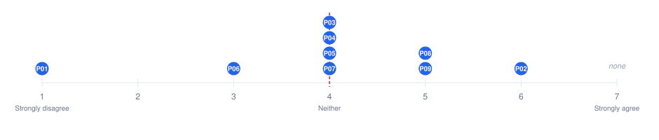

# Hi-AUDiO FLO Participant Survey — Analysis Summary

**Status:** Draft for review. Not yet reviewed, approved, or committed to the repository.  
**Prepared:** 2026-08-19; last revised 2026-08-21  
**Data source:** `docs/participant_survey_responses.csv` (n = 9, 33 columns; Q16/Q17 already corrected to single-item columns)  
**Governing documents:** `docs/ANALYSIS_PLAN.md`, `AGENTS.md`, `CLAUDE.md`  

---

## 1. Scope and Analytic Approach

This document analyses the nine responses to the Hi-AUDiO FLO participant survey and triangulates them against the practice-based evaluation memo (`README.md`, §4–§8). It follows the approach set out in `docs/ANALYSIS_PLAN.md`: Q1–Q20 are summarised descriptively (frequencies, means, medians, ranges). The four free-text list items are handled differently from the fixed-option questions — entries in Q3 and Q4 were categorised by hand and then counted, while Q6 and Q7 are summarised in prose without counts. The open questions Q21–Q23 are analysed through hybrid deductive/inductive thematic coding; findings are then compared against the memo to identify confirmation, nuance, contradiction, or new findings.

The analysis is exploratory and descriptive. **No inferential statistics** (confidence intervals, significance tests, regressions) are computed or implied, consistent with the small, non-random, single-organisation expert cohort (n = 9 FLO performers). All findings below are scoped to FLO participants in this study and should not be generalised beyond it.

Participant identifiers (P01–P09) join to the underlying data through `docs/response_id_mapping.md`, and that join is checkable from material published here: submission dates are unique per respondent and appear in both the CSV and the individual PDFs, and each PDF states a `Submission N` ordinal that agrees with the participant numbering. The per-respondent attributions in §5 and §6 rest on that mapping.

One respondent, **P09, is also a co-designer of the questionnaire and the practice-based memo's author** (disclosed in README §3 as a "Positionality note"). This is treated throughout as a disclosed methodological condition: her response is retained in all primary (n = 9) results, and headline quantitative items are additionally reported with her excluded (n = 8). Full treatment is in §8 below and in `docs/ANALYSIS_PLAN.md` ("Researcher Positionality").

**Provenance of the rating items.** Q18 and Q19 reproduce published technology-acceptance scales: Q18 is the four-item Perceived Ease of Use scale and Q19 the three-item Perceived Enjoyment scale, both as worded in Venkatesh (2000, Appendix 1) — adapted there from Davis (1989) and Davis, Bagozzi and Warshaw (1992) respectively — with the verb tense changed from present to past ("I find…" → "I found…") and the platform named in place of "the system." Q20_2 is Davis's (1989) perceived-usefulness item with the domain changed from "in my job" to "for recording music." Q20_1 and Q20_3 are attitude and behavioural-intention items in the technology-acceptance tradition, but their direct wording source has not been established and none is claimed here. Q20_4, and the single items Q16 and Q17, were written for this study.

Two consequences follow. The instrument *as assembled* is not a standardised questionnaire and was not re-validated for this population: items were recombined across sources and n = 9 cannot establish reliability. Separately, the source scales were written to be answered about a system in current use, whereas this survey was answered retrospectively, months after the evaluation period (§8). Results are therefore descriptive throughout — not compared against published norms for any source scale, and block means are not treated as validated subscale scores. Full attribution is in `docs/REFERENCES.md`.

---

## 2. Sample Description (Q1–Q15)

Nine FLO performers completed the survey. All percentages below use n = 9 as the denominator unless otherwise noted.

**Musical roles (Q1, select all that apply — 29 selections across 9 respondents, ≈3.2 roles per person on average):** Performer (instrumentalist/vocalist) 9/9 (100%), Improviser 6/9 (67%), Composer or arranger 4/9 (44%), Sound engineer 3/9 (33%), Educator 3/9 (33%), Producer 2/9 (22%), Ensemble Leader 1/9 (11%), Audio Researcher 1/9 (11%). The cohort is a multi-role expert group rather than single-specialism performers.

**Prior browser-based recording tool experience (Q2):** 5/9 (56%) had prior experience, 4/9 (44%) did not. Tools named elsewhere in the survey (Q3/Q4) include SoundJack, Sonobus, and BandLab.

**Known similar platforms / DAWs used (Q3, Q4 — free-text list questions, hand-categorised then counted):** Sonobus was the most commonly named comparable platform (Q3: 5/9 respondents), with SoundJack and BandLab tied for second (2/9 each). Software normally used (Q4) was broad and professional-grade: the Ableton family (Ableton/Ableton Live/Ableton Lite) named by 4/9 respondents, Bitwig by 3/9, and Playsound.space — a web-based platform rather than a DAW — also by 3/9, with single mentions of Reaper, Cubase, Digital Performer, Adobe Audition, Vital, and routing/utility tools (Loopback, Audio Hijack). Both are free-text list widgets, so a few entries cross the two categories (P02 listed Bitwig, a DAW, under Q3; P06 listed Sonobus, a network-collaboration tool, under Q4); the counts above follow each tool's actual category rather than the field it was typed into, and no reported figure is affected.

**External audio interface use (Q5):** "Yes, always" 4/9 (44%), "Yes, sometimes" 3/9 (33%), "No — I use built-in audio (laptop or phone microphone)" 2/9 (22%). 78% used an external interface at least some of the time.

**Instruments and proficiency (Q6 — descriptive):** wide instrumentation across the cohort (keyboard, bass guitar, saxophone, guitar, piano, voice, cello, synthesizers, flute, bagpipes, percussion, and others), with proficiency self-ratings spanning Beginner to Expert/Professional. Most respondents reported Intermediate-to-Expert level on at least one instrument.

**What was recorded for the Radiophrenia 2026 Jam (Q7 — descriptive):** voice/vocals, percussion, kazoo, cello, guitar, piano, synth, soundscape, and Supercollider-generated material; one respondent (P09) contributed the session's opening binaural field-recording track — a pre-existing recording (its filename is dated 2025-11-18) that also served as the composition's guide track, rather than material recorded during the evaluation period.

**Recording/upload method (Q8, select all that apply):** direct recording via audio interface + microphone 4/9 (44%); upload after recording in an external sound recorder 2/9 (22%); upload after recording in a DAW 2/9 (22%); routed live from a DAW 2/9 (22%).

**Latency measurement (Q9):** "Not applicable — I only uploaded files" 3/9 (33%); "Yes, every time I recorded something" 3/9 (33%); "Yes, but only once for the whole session" 2/9 (22%); "No" 1/9 (11%, P01).

**Q10 (conditional on Q9 = "No"):** denominator is **n = 1** (P01, the sole respondent who answered literal "No"; the three "Not applicable" respondents were correctly not shown this question by the form's conditional logic). P01's stated reason: *"I didn't think it was necessary"*.

**Session structure (Q11):** single session 5/9 (56%); across several sessions same day 2/9 (22%); across different days 2/9 (22%).

**Time spent (Q12):** more than 60 minutes 4/9 (44%); 30–40 minutes 3/9 (33%); 20–30 minutes 1/9 (11%); less than 20 minutes 1/9 (11%). Most participants (7/9, 78%) spent 30 minutes or more.

**Operating system (Q13):** macOS 8/9 (89%), Windows 1/9 (11%). **Browser (Q14):** Firefox 5/9 (56%), Chromium/Chrome 3/9 (33%), Safari 1/9 (11%).

**Headphones (Q15):** Wired 7/9 (78%), None 2/9 (22%). No respondent reported wireless headphones.

**Sample character:** a small, multi-disciplinary, technically experienced cohort, heavily skewed toward macOS (89%) and, less strongly, Firefox (56%). Engagement varied: just over half (5/9) worked in a single session and most (7/9) spent 30 minutes or more, but only three respondents (P01, P02, P03) met *both* conditions — so a "substantial single sitting" describes some, not most, of the sample, and the two figures should not be read as a joint pattern. The OS/browser skew is noted as a limitation in §8.

---

## 3. Q16 — Headline Result

**Q16 — whether the platform meets the necessary standards as a professional audio recording application** — is the headline metric and is reported first, per governance rules. Its construct is *professional standards specifically*; artistic-intention support is a separate item (Q17, §4), and the two should not be merged into a single "professional/artistic" judgement.

| | n | Mean | Median | Range |
|---|---|---|---|---|
| Q16, full sample | 9 | **4.00** | 4.0 | 1–6 |
| Q16, P09 excluded | 8 | 3.88 | 4.0 | 1–6 |

Both figures sit almost exactly on the 7-point scale's midpoint (4.0 = "Neither disagree nor agree"), indicating a **mixed, centred rather than clearly positive or negative** view of the platform's suitability as a professional audio recording application among this cohort. The distribution shows this is a genuine spread rather than uniform neutrality: one respondent (P01) rated it 1 ("Strongly disagree"), one rated it 3, four rated it 4, two rated it 5 and one rated it 6. No respondent rated it 2, and none selected the scale's top option, "Strongly agree" (7).

***Figure 1.** Distribution of the nine Q16 ratings. Each marker is one respondent. No respondent selected the scale's top option.*

---

## 4. Q16–Q20 — Quantitative Results

### Q17 — Artistic intention support (supporting metric)

| | n | Mean | Median | Range |
|---|---|---|---|---|
| Full sample | 9 | 4.22 | 4.0 | 2–7 |
| P09 excluded | 8 | 3.88 | 3.5 | 2–7 |

Per `docs/ANALYSIS_PLAN.md`, Q17 should be read alongside Q21/Q22 as well as reported numerically. Read that way, the Q21 collaboration theme (contributing to and hearing a shared artistic project) plausibly supports a sense of artistic-intention support, while the Q22 editing-tools gap (§6) plausibly works against it. The survey does not ask respondents to explain their Q17 rating, so this is a reading of the qualitative data rather than an established link.

### Q18 — Pragmatic usability (Perceived Ease of Use; Venkatesh, 2000)

| Item | Statement | n=9 Mean | n=9 Median | n=9 Range |
|---|---|---|---|---|
| Q18_1 | Clear and understandable | 5.33 | 5.0 | 3–7 |
| Q18_2 | Did not require a lot of mental effort | 5.33 | 6.0 | 3–7 |
| Q18_3 | Easy to use | 4.89 | 5.0 | 2–7 |
| Q18_4 | Easy to get it to do what I wanted | 4.00 | 4.0 | 1–7 |

Q18_2 is worded so that a higher score indicates *lower* mental effort; it was not reverse-coded, consistent with `AGENTS.md`. All four items sit at or above the midpoint, with the first-impression items (clarity, mental effort) rated more favourably than the goal-completion item (Q18_4), which sits exactly at the midpoint.

### Q19 — Hedonic/experiential quality (Perceived Enjoyment; Venkatesh, 2000)

| Item | Statement | n=9 Mean | n=9 Median | n=9 Range |
|---|---|---|---|---|
| Q19_1 | Enjoyable | 4.44 | 4.0 | 1–7 |
| Q19_2 | Process was pleasant | 4.67 | 4.0 | 2–7 |
| Q19_3 | Had fun | 4.44 | 4.0 | 2–7 |

All three items sit modestly above the midpoint.

### Q20 — Future use intent and perceived usefulness

| Item | Statement | n=9 Mean | n=9 Median | n=9 Range |
|---|---|---|---|---|
| Q20_1 | Good idea to use for recording music | 4.11 | 4.0 | 2–7 |
| Q20_2 | Would find it useful for recording music | **3.56** | 3.0 | 1–6 |
| Q20_3 | Would plan to use in a future project | 3.89 | 4.0 | 2–6 |
| Q20_4 | Would recommend to colleagues | 4.67 | 5.0 | 2–7 |

**Q20_2 ("would find it useful for recording music") is the lowest-rated of all thirteen 7-point items** (mean 3.56, median 3.0, both below midpoint) — lower even than Q16. Q18_1 and Q18_2 (clarity, low mental effort) are the highest, at 5.33 each. Descriptively, then, **mean ratings indicate the platform was found pleasant and easy to use during the evaluation, and rated lower on average for practical usefulness in future recording work** — though not uniformly so at the item level. §9 weighs that reading against the qualitative and triangulation findings.

***Figure 2.** Mean rating for each of the thirteen items. Filled markers are the full sample (n = 9); hollow markers exclude P09 (n = 8). Exact values are tabulated above and in §5.*

---

## 5. P09-Excluded Sensitivity Analysis (n = 8)

Per the Researcher Positionality guidance in `docs/ANALYSIS_PLAN.md`, all Q16–Q20 items were recomputed excluding P09.

| Item | Mean (n=9) | Mean (n=8) | Δ | Median (n=9) | Median (n=8) |
|---|---|---|---|---|---|
| Q16 | 4.00 | 3.88 | −0.12 | 4.0 | 4.0 |
| Q17 | 4.22 | 3.88 | −0.35 | 4.0 | 3.5 |
| Q18_1 | 5.33 | 5.12 | −0.21 | 5.0 | 5.0 |
| Q18_2 | 5.33 | 5.25 | −0.08 | 6.0 | 5.5 |
| Q18_3 | 4.89 | 4.62 | −0.26 | 5.0 | 4.5 |
| Q18_4 | 4.00 | 3.88 | −0.12 | 4.0 | 3.5 |
| Q19_1 | 4.44 | 4.25 | −0.19 | 4.0 | 4.0 |
| Q19_2 | 4.67 | 4.50 | −0.17 | 4.0 | 4.0 |
| Q19_3 | 4.44 | 4.12 | −0.32 | 4.0 | 4.0 |
| Q20_1 | 4.11 | 3.75 | −0.36 | 4.0 | 3.5 |
| Q20_2 | 3.56 | 3.38 | −0.18 | 3.0 | 3.0 |
| Q20_3 | 3.89 | 3.75 | −0.14 | 4.0 | 3.5 |
| Q20_4 | 4.67 | 4.38 | −0.29 | 5.0 | 4.5 |

*(Δ is computed from the unrounded means and then rounded, so it will not always equal the difference of the two displayed figures.)*

P09 rated all thirteen items between 5 and 7 (mean 6.15), so excluding her lowers every mean slightly (Δ from −0.08 to −0.36). Four items (**Q16, Q17, Q18_4, Q20_1**) move from at-or-just-above the 4.0 midpoint to just below it once she is excluded; no item reverses by more than half a scale point. **Both figures are reported, per the Researcher Positionality guidance, but the divergence does not change the interpretation** — the sample was already centred on the midpoint with P09 included, and remains so without her.

**Important framing note.** P09 is excluded here because of her *disclosed dual role*, not because her ratings are numerically unusual: no outlier test was run, and P02's ratings are equally high (identical mean of 6.15, identical minimum item score of 5) yet P02 has no positionality conflict and is retained everywhere without adjustment. Their distributions differ in shape — P09's cluster at the scale's top end (six of thirteen items at 7), P02's in its upper-middle (seven of thirteen at 6) — so "equally high" holds while "equally uniform" would not. At the other end, P01 rated every item 1 or 2 **except two** (Q18_1 = 5, Q18_2 = 6; mean 2.23, range 1–6). The sample's spread runs from P01 through P07/P06 (mean 3.62 each) to P08 (5.38) and up to P02 and P09 (tied at 6.15). P09's positivity is therefore not unique to her, which is why the n = 8 figures should not be read as correcting an outlier.

***Figure 3.** Each respondent's mean across all thirteen items. The thirteen items span four different constructs, so this mean is a descriptive summary used here only for the positionality comparison — it is not an overall-attitude score and the ranking should not be read as one. P02 and P09 coincide exactly at 6.15, and P06 and P07 at 3.62.*

---

## 6. Q21–Q23 — Thematic Findings

Response rates were verified against the CSV before coding: **Q21: 6/9 answered, Q22: 7/9, Q23: 5/9**. Two of the five Q23 responses (P02: *"no, sorry! just musicians!"*; P01: *"No"*) decline to suggest a use case rather than offering one, so only 3/9 gave a substantive Q23 answer. Q21–Q23 are optional on the form, so blanks are expected item nonresponse, not an export defect or data loss.

Themes are labelled **recurring** (≥2 respondents) or **isolated observation** (1 respondent). Excerpts are attributed by PID only and are quoted exactly as submitted, including respondents' own spelling, list punctuation and spacing.

### Q21 — Most useful/effective aspects (deductive frame: README §4)

**Theme: Collaboration and multi-track listening — recurring (5/6 respondents: P08, P04, P03, P02, P01)**
> P08: *"Ability to collaborate"*
> P03: *"Intuitive understanding, and possibility to listen to the other tracks easily"*

**Partially confirms** README §4.1 (Accessibility), which frames distributed collaboration as a strength: this is the most frequent Q21 theme, but browser-based access itself — §4.1's actual subject — is named by only one respondent, so the accessibility framing is supported only indirectly. The code bundles explicit mentions of collaborating with others (4/6: P08, P04, P02, P01) with P03's mention of listening easily to other tracks, which implies the multi-track collaborative context without naming collaboration — so the dominant benefit is best stated as the collaborative multi-track setting broadly, not "collaboration" as a term respondents themselves converged on. This does **not** independently confirm §4.4 (Track Annotation): no Q21 answer mentions notes, annotations, or track metadata.

**Theme: Ease of use / intuitive interface — recurring (4/6: P09, P08, P03, P02)**
> P09: *"The interface was very easy to understand. I did not need to read a manual or watch any videos..."*
> P02: *"It was so easy to use..."*

**Confirms** README §4.2 (Ease of Use) directly, including a near-verbatim echo of the memo's own quoted phrase ("simple and easy to use").

Browser-based accessibility was mentioned only implicitly (P04: *"...on the browser"*, bundled with collaboration) — present in the data but not independently prominent, in contrast to its centrality in the memo.

### Q22 — Challenges (deductive frame: README §5)

Seven respondents answered. One (P02) reported simply *"No challenges"*; the remaining six (P09, P08, P06, P04, P03, P01) gave substantive answers, and the fractions below are out of those six. P01 also opened with *"No challanges, but..."* (their spelling) before giving the most critical assessment of professional fit in the dataset — they appear to reserve "challenges" for something narrower than the missing professional features they then describe.

**Theme: Absence of editing/audio-manipulation tools — recurring (2/6: P08, P01)**
> P08: *"...[I] would have used it for recording if there was a way to cut, copy, and paste sections of the recording. It would also have been useful to manage the volume enveloppe..."*
> P01: *"No challanges, but it's too basic to use professionally, as we cant choose the record point, can't crop or edit the sound files or do basic sound volume enveloping, so it has no advantage comparing to other software"*

**Confirms** README §5.4 (Editing and Audio Manipulation) closely, down to the specific missing features named (cut/copy/paste, volume envelope). P01's broader framing ("too basic to use professionally") also echoes §7's own assessment of the platform as not yet suited to end-to-end professional workflows — consistent with P01 having given the lowest Q16 (1) and Q17 (2) scores in the sample.

**Theme: Post-recording processing/sync wait time — recurring (3/6: P09, P06, P04)**
> P09: *"...it took a long time for the track to be 'rendered', so I had to keep Firefox open until that was completed..."*
> P06: *"- waiting  time for recorded tracks to be synced with the serwer"*

**Confirms** README §5.6 (Signal Flow and Rendering Stability), which itself opens by citing "long rendering times." The survey's mentions concern wait time specifically, rather than the clipping/artefact example §5.6 elaborates via Loopback routing — a modest difference in emphasis, offered cautiously at this n. This is distinct from Q9, which asks only whether respondents ran the platform's built-in latency measurement before recording; no respondent reported that measurement as a problem. Note also that the three respondents do not describe the same mechanism: P06 names server synchronisation ("synced with the serwer"), while P09 says "rendered" and P04 says "processing" without locating the delay — so a shared *experience* of waiting is well supported, a shared *server-side* mechanism is not.

**Isolated observation: Live input-level control (P06 only)**
> P06: *"- no options to manipulate audio input levels or other audio parameters on the fly when recording"*

**Confirms** README §5.3 (Recording Workflow Limitations), which notes the platform "lacked visible input gain control." Distinct from the editing theme above: this concerns adjusting levels live, during recording, not shaping already-recorded material.

**Isolated observation: Visual feedback / interface clarity (P09 only)**
> P09: *"...did not provide very clear feedback when buttons were pressed (i.e. buttons did not change colour), so it was difficult to see if something was happening or not (visually)."*

**Confirms** README §5.1 directly — but from a single respondent, and specifically the memo's own author. Per the positionality guidance this agreement is expected and is **not** independent corroboration: it is the same authorial voice. Her fuller answer also names transport-bar and Mute/Solo button confusion.

The same answer also lands on **README §5.2**: *"hovering over the 'Headphone' icon shows text 'select cursor' which is confusing as it is very different to DAW"* matches §5.2's note that "the function of the headphones icon (Select Cursor) was not immediately clear to some participants." This qualifies rather than contradicts **§4.3 (Interface Discoverability)**, which cites hover-over labels as an orientation aid: §4.3's example is the Stop control, whose label is self-explanatory, whereas the Headphone icon's label names a different function than the icon depicts — the same mechanism helping in one case and confusing in another, not an internal inconsistency in the memo. Again, this is not independent corroboration.

**Isolated observation, mechanism unclear: possible noise/audio issue during a second take (P03 only)**
> P03: *"Noise were introduced during a second recording session, while also including a sound source from browser. I had to delete it."*

The respondent does not specify how this happened, so it is reported as a tentative single-respondent observation rather than a confirmed "signal bleed" or "capture" mechanism. It sits adjacent to, but does not clearly match, README §5.6's routing/artefact examples — no routing tool or clipping is named.

No respondent raised file-format compatibility, browser/network compatibility, or the absence of keyboard shortcuts as a Q22 challenge — all three despite the first two belonging to the deductive frame. File-format friction (§5.8) and missing keyboard shortcuts (§5.2) have their own memo subsections, so their absence here is reportable (see §7.1). Browser behaviour is a different case: the memo has no §5 subsection for it and treats browser-based access as a strength (§4.1), but Appendix B does record browser-specific friction — a Firefox microphone-permission icon that was sometimes hidden (Fig B2), and a browser refresh being needed before Loopback appeared as an input device (Fig B3). Neither was raised by any respondent. Transport-related concerns do appear (P09's transport-bar/Mute/Solo comments; P01's inability to choose the record point) but fall within the visual-feedback and editing themes above rather than forming a separate recurring theme.

### Q23 — Other use cases (deductive/inductive, per README §6/§7)

Three respondents gave substantive suggestions. **Peer ensemble collaboration** is a recurring theme at the broad level (**2/3: P04, P06**), though the two proposed applications differ — cross-timezone collaboration versus lighter-weight preliminary sessions — so each is presented separately below. The code is defined narrowly, as peer ensemble work: P09's remote-education scenario also involves two parties exchanging recordings, but the relationship there is asymmetric and pedagogical rather than co-creative, so it is coded as its own theme. Under a broader definition the count would be 3/3; the narrow reading is used because README §4.1's collaboration framing concerns distributed performers co-producing a single work.

**Isolated, inductive — new finding, proposed as an extension rather than a current capability: Remote music education (P09 only)**
> P09: *"Hi-Audio platform would be very useful in remote music education. ...a teacher can record introductory videos... They can then record a simple scale, upload sheet music for the scale, and the child can play along with this recording to practice. When they think they have practised enough, they can record a track. The teacher will review it, give them feedback... I understand this is a completely different view of how the platform could be used, and would involve changes to the platform, but it is worth thinking about."* (condensed from a longer response describing a full remote-teaching scenario for a hypothetical student without access to a nearby music school; her closing sentence is quoted in full)

Not addressed anywhere in README §4–§8, and the only substantively new use case in the Q23 set. It is reported here with the qualification P09 herself attached to it: the scenario turns on capabilities the evaluated version did not have — uploading video lessons and sheet music, and reviewing past sessions — and she states plainly that it "would involve changes to the platform." It is therefore a proposed direction for development, not evidence that the platform as evaluated fits an educational context. This distinguishes it from the two Q23 suggestions below, which describe uses the platform already supports.

**Isolated — nuances §7: Preliminary jam/collaboration sessions (P06 only)**
> P06: *"- preliminary jam/collaboration sessions"*

§7 concludes the platform is not yet fit for *end-to-end* professional production. P06's suggestion is consistent with that conclusion rather than contradicting it: it fits the platform to a lighter-weight preliminary/rehearsal use — a positive framing of the same limitation.

**Isolated — confirms/extends §4.1: Distributed, cross-timezone collaboration (P04 only)**
> P04: *"Distributed collaborations across different locations and time zones"*

Extends the existing accessibility/collaboration strength prospectively rather than introducing a new one. With P06's suggestion above, this forms the 2/3 collaborative-use theme noted at the start of this section.

**Counterweight.** Two of the five who answered Q23 named no further context: P01 answered *"No"*, and P02 *"no, sorry! just musicians!"* — the latter an explicit claim that the platform's applicability does not extend beyond musicians, which bears on §7's platform-fit assessment. These are responses, not silence, and are reported as data: **2 of the 5 who answered Q23 named no further use case.** Neither is raised to a coded theme, because "declined to name one" is not a substantive shared idea; P02's scope limitation *is* content, and is recorded as such in the sentence above.

---

## 7. Triangulation with the Practice-Based Memo

| README section | Survey evidence | Relationship |
|---|---|---|
| §4.1 Accessibility | Q21: collaboration/multi-track theme (5/6); explicit collaboration mentions 4/6 | **Partially confirms** — browser-based access itself is named by only one respondent (P04), so the accessibility framing is confirmed indirectly. Does **not** confirm §4.4 Track Annotation: no respondent mentioned notes or annotations |
| §4.2 Ease of Use | Q21: ease-of-use theme (4/6); Q18_1/Q18_2 highest-rated items (5.33 each) | **Confirms** strongly, quantitatively and qualitatively |
| §5.1 Visual Feedback and Interface Clarity | Q22: P09's isolated comment | **Confirms**, but non-independent (same authorial voice as the memo) |
| §5.2 Transport Controls and Navigation | Q22: P09's Headphone-icon comment; P01's "cant choose the record point" | **Confirms** the icon-clarity point (non-independent); **qualifies** §4.3, whose hover-label example is the Stop control. §5.2's keyboard-shortcut and Fast Forward/Rewind points drew no mention |
| §5.3 Recording Workflow Limitations | Q22: P06's live input-level control observation | **Confirms** (isolated, single-respondent) |
| §5.4 Editing and Audio Manipulation | Q22: editing-absence theme (2/6); Q20_2 lowest-rated item (3.56) | **Confirms.** Plausibly consistent with the muted future-use results, though the survey does not ask why Q20_2 was rated low |
| §5.6 Signal Flow and Rendering Stability | Q22: processing/sync wait-time theme (3/6) | **Confirms** — §5.6 already names "long rendering times"; the wait-time emphasis is a modest nuance, not a new one |
| §5 (no clean subsection match) | Q22: P03's noise/audio observation | **Tentative** — mechanism unclear; adjacent to but not a clean match for §5.6 |
| §6 Design Implications | Q22/Q23 findings generally | **Partially confirms.** Three of the four priorities the survey speaks to have independent support — editing tools (2/6), input control (P06) and rendering stability (3/6). Visual feedback is raised only by P09, the memo's own author, so it is not independently corroborated (§7.1) |
| §7 Platform Fit | Q16 (4.00/3.88, centred on midpoint); Q17 (4.22/3.88); Q20 (mixed, Q20_2 lowest of all items) | **Confirms** §7's reading of the platform as "a lightweight multitrack recording environment rather than a fully featured creative production system" — centred results align with a qualified rather than unqualified fit |
| §7 / §8.2 (not addressed) | Q23: P09's remote-education suggestion | **New finding**, but a proposed *extension*: P09 states it "would involve changes to the platform," so it does not bear on the fit of the version evaluated |

*Denominators differ by question and are not a common scale: Q21 fractions are out of the **6 respondents who answered Q21**; Q22 fractions are out of the **6 substantive answers** among the 7 who answered (P02's "No challenges" carries no content to code); Q23 fractions are out of the **3 substantive answers**. See §6.*

### 7.1 Memo findings the survey does not corroborate

The table above has rows only where survey evidence exists. Read alone, that hides an equally reportable result: several memo findings — including three of the four development priorities README §8 calls "the most critical areas for development" — drew no independent support from this survey. Denominators below are the six substantive Q22 answers, as in §6.

| README §8 critical area | Independent survey support |
|---|---|
| Improved visual feedback for active states | **P09 only** — and P09 authored the memo, so this is non-independent by the positionality rule applied throughout |
| Standard keyboard shortcuts | **No mention** in any Q22 answer |
| Uncompressed export formats (§5.8, .m4a friction) | **No mention** in any Q22 answer |
| Basic non-destructive editing tools | **2/6** (P08, P01) — the only one of the four with independent survey support |

Three further memo subsections drew no survey mention at all: **§5.5** (accidental timeline shifts), **§5.7** (pinch-to-zoom / gestural support), and **§5.9** (track renaming). **§4.4** (Track Annotation) is likewise unconfirmed — no Q21 answer mentions notes or annotations (see the §4.1 row above).

**How to read this.** Absence of mention in a small, optional free-text question is **not evidence of absence**: the memo drew on sustained observation across the whole evaluation period, which a single retrospective item cannot replicate, and the survey did not ask about these areas directly, did not measure export behaviour, and cannot show whether respondents reached the relevant workflow stage. The narrow claim is only that these issues were not raised spontaneously in the Q22 answers. (Note that README §5.2 locates the keyboard-shortcut cost *inside* the platform — the missing Spacebar Play/Stop slowing recording sessions — not at the point of export.) This is a descriptive observation about where survey and memo evidence overlap, not a recommendation to reweight §8's priorities.

**Narrative summary:** where the survey speaks to a memo finding it confirms it, and no survey finding contradicts the memo — but it does not speak to all of them, as §7.1 sets out. The most frequently recurring Q22 concern is post-recording wait time (3/6), directly confirming §5.6; the editing/audio-manipulation gap (2/6) is mentioned less often but is where the survey's most critical respondent, P01, concentrated their comments. One clearly new observation emerges (P09's remote-education use case) alongside one tentative single-respondent observation whose mechanism the data does not establish (P03's noise/audio issue during a second take).

---

## 8. Limitations and Researcher Positionality

- **Sample size and scope.** n = 9, a small, non-random, single-organisation expert cohort (FLO performers). Descriptive statistics only; findings are scoped to "FLO participants in this study" and should not be generalised to other users, platforms, or contexts.
- **Platform/browser skew.** 8/9 respondents used macOS and 5/9 used Firefox; only one data point exists for Windows and for Safari each. Findings may under-represent OS- or browser-specific issues.
- **Partial response to open questions.** Q21–Q23 were answered by 6/9, 7/9, and 5/9 respondents respectively (only 3/9 gave a substantive Q23 answer). Thematic findings in §6 reflect these smaller subsets, not the full n = 9.
- **Researcher positionality (P09).** P09 co-designed the questionnaire and authored the practice-based memo against which findings are triangulated (disclosed in README §3, which also discloses that the questionnaire's other co-designer is the Hi-AUDiO Lead Software Engineer, who is not a respondent). Handling here: (a) she is retained in all primary n = 9 results; (b) Q16–Q20 are additionally reported at n = 8 excluding her (§5); (c) her Q22 comment on visual feedback is flagged as non-independent corroboration of her own memo's §5.1; (d) her Q23 education-use-case suggestion is flagged as sourced solely from her. As §5 shows, her ratings are high but not numerically unique (P02's mean and floor are identical) — the n = 8 figures are a transparency measure tied to her disclosed role, not an outlier correction.
- **Instrument caveat.** Q18 and Q19 reproduce Venkatesh's (2000) Perceived Ease of Use and Perceived Enjoyment scales, and Q20_2 is Davis's (1989) usefulness item; but the instrument as assembled recombined items across sources, changed their tense from present to past, and was never re-validated. Absolute scores are therefore read descriptively and are not compared to published norms (see §1 and `docs/REFERENCES.md`).
- **Retrospective self-report, collected months after use.** The evaluation period ended on 13 March 2026; responses were submitted between 20 May and 3 July 2026, a lag of **68 to 112 days**. Several questions, Q22 in particular, ask respondents to recall specific interface behaviours — which icons were unclear, how long rendering took, whether a control responded as expected — and a gap of this length gives no reason to expect recall of that detail to be complete, so absence of a specific complaint may reflect imperfect memory rather than absence of the problem. The data cannot say how often it does. This reinforces the caution in §7.1. The intervals are measured from the common evaluation end date and the survey did not record when each respondent last used the platform, so an individual's actual gap may be longer; the lag also varies across the sample by 44 days, so respondents were not all recalling from the same distance.
- **Single time point, within a communicating cohort.** All data was collected in one wave, within a cohort that communicated informally (WhatsApp group, per README §3) during the study — some convergence in language or emphasis between respondents may partly reflect shared discussion rather than fully independent impressions.

---

## 9. Conclusions

Among FLO participants in this study, the platform's perceived suitability as a professional audio recording application (Q16) sits almost exactly at the 7-point scale's midpoint (mean 4.00, n = 9; 3.88 with P09 excluded), indicating a mixed rather than clearly positive or negative view. This is not uniform neutrality: ratings range from strongly critical (P01, "Strongly disagree") to clearly positive (P02 "Agree," P09 "Somewhat agree"), and no respondent selected the scale's top option on Q16.

Several findings converge across the quantitative and qualitative data. **Collaboration and ease of use are the platform's clearest strengths** in this cohort — the top qualitative theme in Q21 and the highest-rated quantitative items (Q18_1/Q18_2, both 5.33). On the concern side the picture has two parts: **post-recording processing/sync wait time is the most frequently recurring Q22 concern** (3/6 substantive answers), while **the absence of editing/audio-manipulation tools, mentioned less often (2/6), is where the survey's most critical respondent concentrated their comments** — P01, who also gave the lowest Q16 and Q17 scores. Q20_2 ("would find it useful for recording music") is the lowest-rated quantitative item in the survey (mean 3.56); the editing-tools gap is a plausible contributor, though the survey does not establish this causally.

A more cautious observation: averaging the item means within each block gives 4.06 for Q20, 4.89 for Q18 and 4.52 for Q19, so the future-use items sit lower on average than the usability and enjoyment items. These are arithmetic averages of item means, not subscale scores — the blocks were not validated as scales here (§1), Q20 mixes attitude, usefulness, intention and recommendation rather than measuring one thing, and the pattern is not uniform at the item level, since Q20_4 ("would recommend to colleagues," 4.67) matches or exceeds several Q18 and Q19 items. Read with those limits, the cohort rated the platform well on clarity and low mental effort during use (Q18_1/Q18_2, 5.33 each), only modestly above the midpoint on enjoyment (Q19 means 4.44–4.67, all three medians exactly 4.0), and lower again across the Q20 items, of which only Q20_3 asks directly about a future project — a shape consistent with README §7's own assessment of the platform as well-suited to lightweight collaborative use but not yet to end-to-end professional production.

Survey findings triangulate closely with the practice-based memo, contradicting none of its findings and confirming those they speak to. Coverage is partial: three of the four development priorities named in README §8 (visual feedback, keyboard shortcuts, uncompressed export formats) received no independent support here, and only non-destructive editing tools was independently corroborated (§7.1) — which, given a small cohort and an optional free-text challenge question, is not disconfirmation. One clearly new observation emerges, P09's suggested remote music-education use case, alongside one tentative single-respondent observation, P03's noise/audio issue during a second take, whose mechanism the data does not establish. Neither is yet corroborated within this sample.

---

*End of draft. Not committed. Awaiting review.*
