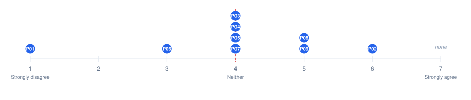

# Hi-AUDiO FLO Participant Survey — Analysis Summary

**Authors:** [Nela Brown](https://nelabrown.blogspot.com/) ([FLO Lab](https://femalelaptoporchestra.org/flo-lab/), [Female Laptop Orchestra](https://femalelaptoporchestra.org/)) and [José M. Gil Panal](https://github.com/gilpanal) ([Hi-AUDiO](https://hi-audio.imt.fr/), Télécom Paris)  
**Prepared:** 2026-08-19 · last revised 2026-11-25

All nine Female Laptop Orchestra (FLO) performers who evaluated Hi-Audio answered a follow-up survey. This report examines how well the platform met their recording needs and compares their responses with the findings in Nela Brown’s [evaluation memo](memo.html).

## At a glance

Performers valued having one place to bring their recordings together. They differed on whether Hi-Audio offered what they expected from professional recording software.

- **Did Hi-Audio meet professional recording standards?** Three performers agreed, four chose neutral and two disagreed. Their average was exactly the neutral point, 4.00 out of 7.
- **What worked well?** Of the six performers who described a strength, five mentioned collaborating or hearing the other tracks and four mentioned ease of use. Across all nine, clarity and low mental effort received the highest average ratings, both 5.33 out of 7.
- **What got in the way?** Of the six performers who described a difficulty, three mentioned waiting for a new track to be ready. Two wanted to cut passages or change the volume within a take. The lowest-rated statement was about finding Hi-Audio useful for recording music (3.56 out of 7).
- **Which improvements did other performers ask for?** Of the four changes Brown prioritised in her memo, basic editing also came up in two other performers’ comments. Only Brown mentioned difficulty seeing which buttons were active. Nobody mentioned keyboard shortcuts or saving uncompressed audio files in the open question about difficulties.

These findings describe one ensemble’s experience. Brown also performed and answered the survey. The average for professional standards was 3.88 among the other eight performers.

## Contents

- [1. How we analysed the survey](#1-how-we-analysed-the-survey)
- [2. Who took part and how they recorded](#2-who-took-part-and-how-they-recorded)
- [3. Did Hi-Audio meet professional recording standards?](#3-did-hi-audio-meet-professional-recording-standards)
- [4. How performers rated the recording experience](#4-how-performers-rated-the-recording-experience)
- [5. The ratings with and without the evaluator](#5-the-ratings-with-and-without-the-evaluator)
- [6. What performers said in their own words](#6-what-performers-said-in-their-own-words)
- [7. How the survey compares with the evaluation memo](#7-how-the-survey-compares-with-the-evaluation-memo)
- [7.1 Which development priorities did other performers raise?](#71-which-development-priorities-did-other-performers-raise)
- [8. What limits the conclusions?](#8-what-limits-the-conclusions)
- [9. Conclusions](#9-conclusions)
- [References](#references)
- [Appendix: Survey questions](#appendix-survey-questions)

---

## 1. How we analysed the survey

Performers answered 23 questions about their musical background, how they contributed tracks, and their experience of Hi-Audio. All nine answered the rating questions. The three questions that invited comments were optional, so the number of replies varies. The [appendix gives the wording of every question](#appendix-survey-questions).

For background and equipment, we counted how many people chose each answer. Two questions allowed several selections. We grouped the names of music tools by hand before counting them (Q3 and Q4). Performers also listed instruments and the sounds they contributed (Q6 and Q7). We summarised those lists in prose, without counting individual instruments or sounds.

For the 13 rating statements, we converted agreement into numbers from 1 (*Strongly disagree*) to 7 (*Strongly agree*). A rating of 4 meant *Neither disagree nor agree*. The tables give the mean (average), the median (middle of the ordered responses) and the range (lowest to highest response). A mean near 4 can result from people holding quite different views. Some questions came from published scales. We used each rating descriptively because the combined questionnaire had not been validated for this group. The [appendix explains where the questions came from](#where-the-rating-questions-came-from).

For the written answers, one researcher grouped comments by topic. The initial topics came from the memo, such as ease of use and editing. The researcher also recorded ideas that went beyond it. We then compared the comments and ratings with the memo’s observations on strengths, difficulties and suitability for professional work (memo §4–§8).

The labels P01 to P09 identify individual performers. P09 is Brown, who wrote the memo and helped design the questionnaire. We include her in the main results and show every rating again for the other eight. We also identify the comments for which she is the only source. This small group from one ensemble supports a descriptive account. We did not use significance tests, confidence intervals or regressions.

---

## 2. Who took part and how they recorded

### Musical background and recording tools

All nine respondents were instrumentalists or vocalists. Many had other musical roles, including improvising, arranging or working with sound. They selected 29 roles in all, about 3.2 per person (Q1).

| Musical role | Performers out of nine |
|---|---|
| Instrumentalist or vocalist | 9 (100%) |
| Improviser | 6 (67%) |
| Composer or arranger | 4 (44%) |
| Sound engineer | 3 (33%) |
| Educator | 3 (33%) |
| Producer | 2 (22%) |
| Ensemble leader | 1 (11%) |
| Audio researcher | 1 (11%) |

Their instruments included keyboards, piano, synthesizers, guitar, bass guitar, saxophone, cello, flute, bagpipes, percussion and voice (Q6). Players rated their proficiency from beginner to expert or professional. Most reported at least intermediate proficiency on one instrument.

Five of the nine (56%) had previously used a browser-based recording tool, and four (44%) had not (Q2). Asked which comparable platforms they knew (Q3), five named Sonobus, two named SoundJack and two named BandLab.

The software they usually used to make music (Q4) gives a sense of the tools they brought to this project. Four named a version of Ableton and three named Bitwig, both digital audio workstations (DAWs), the software musicians use to record, edit and mix audio. Three also named the web platform Playsound.space. Reaper, Cubase, Digital Performer, Adobe Audition, Vital, Loopback and Audio Hijack each appeared once. For tools named in both lists, we counted each person once in the appropriate category. For example, P02 listed Bitwig among comparable platforms as well as under usual software, and P06 listed Sonobus in both places.

### What the performers contributed

The tracks included voices, percussion, kazoo, cello, guitar, piano, synthesizer, soundscape and sounds generated with SuperCollider (Q7). The first track served as a guide for the piece. P09 uploaded this binaural field recording, made before the project. Its filename is dated 18 November 2025.

Performers could record into Hi-Audio, send it live audio from another program, or upload a file they had already recorded. They could select more than one method (Q8).

| How tracks were added | Performers out of nine |
|---|---|
| Recorded directly through an audio interface and microphone | 4 (44%) |
| Uploaded a file recorded on a separate sound recorder | 2 (22%) |
| Uploaded a file recorded in a DAW | 2 (22%) |
| Routed live audio from a DAW into Hi-Audio | 2 (22%) |

### Equipment, timing and recording sessions

In their usual recording practice (Q5), four performers (44%) always used an external audio interface, three (33%) sometimes used one and two (22%) relied on a laptop or phone microphone. In total, seven of nine (78%) used an external interface at least some of the time.

Hi-Audio includes a test for audio latency, the delay as sound travels through the playback and recording setup. Before recording (Q9), three performers (33%) ran the test every time and two (22%) ran it once for the session. Three others (33%) only uploaded files. The one performer who selected “No” (11%, P01) was the only person asked the follow-up question about skipping the test (Q10). P01 answered *"I didn't think it was necessary"*.

| Session detail | Responses out of nine |
|---|---|
| When tracks were added (Q11) | 5 in one sitting (56%), 2 in several sessions on the same day (22%), 2 across different days (22%) |
| Total time on the platform (Q12) | 4 over 60 minutes (44%), 3 between 30 and 40 minutes (33%), 1 between 20 and 30 minutes (11%), 1 under 20 minutes (11%) |
| Operating system (Q13) | 8 macOS (89%), 1 Windows (11%) |
| Browser (Q14) | 5 Firefox (56%), 3 Chromium/Chrome (33%), 1 Safari (11%) |
| Headphones (Q15) | 7 wired (78%), 2 used none (22%), 0 wireless |

Seven performers (78%) spent at least 30 minutes on the platform, and five worked in a single sitting. Three did both (P01, P02 and P03). Most of the experience described here therefore comes from musicians familiar with recording software, using macOS, with a mix of shorter and longer sessions.

---

## 3. Did Hi-Audio meet professional recording standards?

The main survey question (Q16) asked whether Hi-Audio met the standards performers expected of a professional audio recording application. It asked for their judgement after making the piece. A separate question asked whether the platform helped them realise their artistic intentions.

The nine answers ranged from 1 (*Strongly disagree*) to 6 (*Agree*). Four performers chose 4, the neutral response. Two disagreed (one at 1 and one at 3), and three agreed (two at 5 and one at 6). Nobody selected 2 or 7. Both the mean and the median were 4, but the responses on either side show that performers differed in their assessment.

| Whose ratings are included | Number of performers | Mean | Median | Range |
|---|---|---|---|---|
| All performers | 9 | **4.00** | 4.0 | 1–6 |
| Performers other than the evaluator | 8 | 3.88 | 4.0 | 1–6 |

***Figure 1.** Each dot is one performer’s answer about professional recording standards. The four dots at the midpoint show how many chose the neutral response.*

---

## 4. How performers rated the recording experience

The remaining 12 statements asked about artistic intentions, ease of use, enjoyment and possible future use. All nine performers answered each statement on the same seven-point scale.

### Did Hi-Audio help performers realise their artistic intentions?

On whether Hi-Audio helped them achieve what they had in mind artistically (Q17), the mean was 4.22, just above neutral. Individual answers ranged from 2 to 7.

| Whose ratings are included | Number of performers | Mean | Median | Range |
|---|---|---|---|---|
| All performers | 9 | 4.22 | 4.0 | 2–7 |
| Performers other than the evaluator | 8 | 3.88 | 3.5 | 2–7 |

One performer described being able to hear the other tracks easily. Two wanted to edit their takes in ways the platform did not allow. Those comments suggest ways the platform could help or hinder creative work. The survey did not ask performers to explain their artistic-intention rating, so we cannot tell which experiences shaped any individual score.

### How easy was Hi-Audio to use?

Performers generally found the interface clear and felt that it required little mental effort. Those two statements had the highest means in the survey, both 5.33. Getting Hi-Audio to do what the performer wanted was a different matter. That average was 4.00, with answers spanning the entire scale. These four questions cover *Perceived Ease of Use* (Q18, Venkatesh, 2000).

| Survey item | Statement in brief | Mean | Median | Range |
|---|---|---|---|---|
| Q18_1 | Clear and understandable | 5.33 | 5.0 | 3–7 |
| Q18_2 | Did not require a lot of mental effort | 5.33 | 6.0 | 3–7 |
| Q18_3 | Easy to use | 4.89 | 5.0 | 2–7 |
| Q18_4 | Easy to get it to do what I wanted | 4.00 | 4.0 | 1–7 |

Agreement with the mental-effort statement means the performer found the interaction *less* demanding. A higher number therefore already points in the same direction as the other ease-of-use ratings.

### Did performers enjoy using Hi-Audio?

The three questions about *Perceived Enjoyment* (Q19, Venkatesh, 2000) had means between 4.44 and 4.67, slightly above neutral. The median was exactly 4 for each, and individual experiences varied.

| Survey item | Statement in brief | Mean | Median | Range |
|---|---|---|---|---|
| Q19_1 | Enjoyable | 4.44 | 4.0 | 1–7 |
| Q19_2 | Process was pleasant | 4.67 | 4.0 | 2–7 |
| Q19_3 | Had fun | 4.44 | 4.0 | 2–7 |

### Would performers use Hi-Audio again or recommend it?

Participants were more inclined to recommend Hi-Audio to colleagues (mean 4.67) than to plan to use it in their own next project (3.89). The statement about finding Hi-Audio useful for recording music received the lowest mean of all 13 statements (3.56), with a median of 3 (*Somewhat disagree*).

| Survey item | Statement in brief | Mean | Median | Range |
|---|---|---|---|---|
| Q20_1 | Good idea to use for recording music | 4.11 | 4.0 | 2–7 |
| Q20_2 | Would find it useful for recording music | **3.56** | 3.0 | 1–6 |
| Q20_3 | Would plan to use in a future project | 3.89 | 4.0 | 2–6 |
| Q20_4 | Would recommend to colleagues | 4.67 | 5.0 | 2–7 |

Averaging the statement means within each group gives 4.89 for ease of use, 4.52 for enjoyment and 4.06 for possible future use. These are descriptive averages. The last group combines four different judgements, and only Q20_3 asks directly about the next project. The 4.67 mean for recommending Hi-Audio was as high as or higher than several ease-of-use and enjoyment ratings. The averages therefore hide some important differences between statements.

***Figure 2.** Each row shows the mean for one statement. Filled dots include all nine performers. Open dots show the other eight after removing the evaluator’s answer. The dashed line marks the neutral response of 4. The [comparison table](#5-the-ratings-with-and-without-the-evaluator) gives the exact values.*

---

## 5. The ratings with and without the evaluator

Brown took part in the recording project and was one of the nine people whose experience the survey set out to describe. Because she also helped design the questions and wrote the memo, we repeated the calculations using only the other eight performers. This is a sensitivity analysis. It shows how much her answers affect each result.

For professional standards, the mean went from 4.00 to 3.88 and the median stayed at 4. For support for artistic intentions, the mean went from 4.22 to 3.88 and the median from 4 to 3.5. The broad reading of professional suitability as mixed holds in both groups.

| Statement in brief | Mean, all 9 | Mean, other 8 | Change in mean | Median, all 9 | Median, other 8 |
|---|---|---|---|---|---|
| Meets professional standards (Q16) | 4.00 | 3.88 | −0.12 | 4.0 | 4.0 |
| Supported artistic intentions (Q17) | 4.22 | 3.88 | −0.35 | 4.0 | 3.5 |
| Clear interaction (Q18_1) | 5.33 | 5.13 | −0.21 | 5.0 | 5.0 |
| Low mental effort (Q18_2) | 5.33 | 5.25 | −0.08 | 6.0 | 5.5 |
| Easy to use (Q18_3) | 4.89 | 4.63 | −0.26 | 5.0 | 4.5 |
| Easy to do what I wanted (Q18_4) | 4.00 | 3.88 | −0.12 | 4.0 | 3.5 |
| Enjoyable (Q19_1) | 4.44 | 4.25 | −0.19 | 4.0 | 4.0 |
| Pleasant process (Q19_2) | 4.67 | 4.50 | −0.17 | 4.0 | 4.0 |
| Fun (Q19_3) | 4.44 | 4.13 | −0.32 | 4.0 | 4.0 |
| Good idea for recording (Q20_1) | 4.11 | 3.75 | −0.36 | 4.0 | 3.5 |
| Useful for recording (Q20_2) | 3.56 | 3.38 | −0.18 | 3.0 | 3.0 |
| Would plan to use in next project (Q20_3) | 3.89 | 3.75 | −0.14 | 4.0 | 3.5 |
| Would recommend to colleagues (Q20_4) | 4.67 | 4.38 | −0.29 | 5.0 | 4.5 |

*The change is the mean for the eight minus the mean for all nine, calculated before rounding. Means and changes are rounded to two decimal places. An exact tie rounds towards the more positive value.*

Brown (P09) gave every statement a rating from 5 to 7. Removing her response lowered each mean by 0.08 to 0.36 points. Four means moved from at or just above neutral to just below it. These concerned professional standards (Q16), artistic intentions (Q17), getting Hi-Audio to do what one wanted (Q18_4), and whether using it for recording would be a good idea (Q20_1).

P02 and P09 each averaged 6.15 across the statements and gave no rating below 5. The reason for showing the results without P09 is her role in the evaluation.

***Figure 3.** Each dot shows one person’s mean across all 13 statements. P02 and P09 share the highest mean (6.15), and P06 and P07 also share a mean (3.62). The averages put the evaluator’s answers in the context of the other eight. These statements cover several aspects of recording, so the figure should not be read as a ranking of overall attitudes.*

---

## 6. What performers said in their own words

The final three questions invited performers to describe their experience in their own words. The counts below use the number of people who gave a relevant answer to each question.

| Optional question | People who replied (out of nine) | What they reported |
|---|---|---|
| What was useful? (Q21) | 6 | All six described something they valued. |
| Were there challenges? (Q22) | 7 | Six described a difficulty. One (P02) answered *"No challenges"*. |
| Where else might Hi-Audio be useful? (Q23) | 5 | Three suggested a use. Two replied without proposing a further use. |

An answer can cover several topics. We call a topic recurring when at least two people raised it and identify observations from a single person separately. The excerpts retain the performers’ wording and spelling. Ellipses mark omitted words.

### What worked well?

**Working with other performers’ tracks (5 of 6).** Four people explicitly mentioned collaborating (P01, P02, P04 and P08). A fifth, P03, described being able to listen easily to the other tracks. Counting only explicit references to collaboration gives four. Including listening to others in the shared session gives five.

> P08: *"Ability to collaborate"*
> P03: *"Intuitive understanding, and possibility to listen to the other tracks easily"*

This partly supports the memo’s account of browser access as a benefit for a distributed ensemble (§4.1). P04 was the only person to mention working “on the browser”. The other comments tell us what people valued about making a piece together, with little evidence about how important browser access itself was to them.

**Ease of use (4 of 6).** P02, P03, P08 and P09 described Hi-Audio as easy or intuitive. The memo describes a similar first impression in the words “simple and easy to use” (§4.2). P09 wrote that memo, and three other performers expressed a similar view.

> P09: *"The interface was very easy to understand. I did not need to read a manual or watch any videos..."*
> P02: *"It was so easy to use..."*

**Streaming quality (1 of 6).** P02 also praised the quality of “streaming / collaboration”. This was the only comment about quality. The wording leaves open whether P02 meant the sound of shared playback or the experience of collaborating.

> P02: *"...the quality of the streaming / collaboration"*

### What got in the way?

Of the six performers who described a difficulty, three reported waiting and two described missing editing tools. The other observations below each came from one person.

**Waiting for tracks (3 of 6).** P04 said waiting for a track to process interrupted the creative workflow. P06 described a wait for synchronisation with the server. P09, the memo’s author, used the word “rendered” and had to leave the browser open. All three experienced a delay. Only P06 identified where they thought it occurred.

> P09: *"...it took a long time for the track to be 'rendered', so I had to keep Firefox open until that was completed..."*
> P06: *"- waiting  time for recorded tracks to be synced with the serwer"*

The memo also records long rendering times (§5.6). Its example describes distortion while routing audio through Loopback. The survey comments support the observation about waiting and leave its technical cause open. The separate latency question (Q9) concerned a test run *before* recording. Nobody described that test as a difficulty.

**Editing a take (2 of 6).** P08 wanted to cut, copy and paste a passage and change its volume over time. P01 wanted to choose where recording started, crop a file and adjust its volume. P01 opened with “No challanges, but” and then explained why those missing tools mattered for professional use. This performer gave the lowest rating for professional standards (1) and also rated support for artistic intentions at the bottom of the observed range (2).

> P08: *"...i would have used it for recording if there was a way to cut, copy, and paste sections of the recording. It would also have been useful to manage the volume enveloppe..."*
> P01: *"No challanges, but it's too basic to use professionally, as we cant choose the record point, can't crop or edit the sound files or do basic sound volume enveloping, so it has no advantage comparing to other software"*

Both accounts support the memo’s finding about missing editing tools (§5.4). P01 also made the connection to professional work explicit, as the memo does in §7.

**Adjusting the input level while playing (1 of 6).** P06 wanted to change the incoming audio level during recording. This is a different operation from changing the volume of a take afterwards. The memo records a similar difficulty with input gain (§5.3).

> P06: *"- no options to manipulate audio input levels or other audio parameters on the fly when recording"*

**Seeing which controls were active (1 of 6).** P09 had trouble telling whether a button press had taken effect, including on the playback and recording controls and the Mute and Solo buttons. The memo describes the same problem (§5.1). Both accounts come from the same person.

> P09: *"...did not provide very clear feedback when buttons were pressed (i.e. buttons did not change colour), so it was difficult to see if something was happening or not (visually)."*

P09 also found the headphones icon confusing because its hover label read “select cursor” (§5.2). The memo gives a different example where showing a label helped new users identify the Stop button (§4.3). Together these examples show why the wording of a label matters. P01’s comment about choosing a recording start point also concerned navigation. These two performers described different problems with the controls.

**Noise during a second recording session (1 of 6).** P03 heard noise while including sound from a browser and deleted the recording. The account does not identify a cause or name the routing or clipping problem described in memo §5.6.

> P03: *"Noise were introduced during a second recording session, while also including a sound source from browser. I had to delete it."*

Nobody mentioned a file-format or browser/network compatibility problem in these answers. The memo describes file export in §5.8 and documents two browser-specific examples in Appendix B (Figs B2–B3). A Firefox microphone-permission icon was sometimes hidden, and a browser refresh was needed for Loopback to appear as an input. Neither example came up in the survey. The [development priorities table](#71-which-development-priorities-did-other-performers-raise) also covers keyboard shortcuts.

### What other uses did performers suggest?

Three performers proposed another way to use Hi-Audio. Two described musicians working as peers (P04 and P06). One proposed a new setting, teaching a student remotely (P09). Two others answered the question without suggesting another use. P01 wrote *"No"*. P02 saw it as a tool for musicians, writing *"no, sorry! just musicians!"*. The four remaining performers left the question blank.

**Working across locations and time zones (P04).** This suggestion extends the memo’s observation about remote collaboration (§4.1) to ensembles whose members work at different times.

> P04: *"Distributed collaborations across different locations and time zones"*

**Preliminary jam or rehearsal sessions (P06).** The suggestion identifies a stage of production where the platform could already be useful. It fits the memo’s assessment that Hi-Audio could support parts of a professional project (§7).

> P06: *"- preliminary jam/collaboration sessions"*

We grouped these two answers together because both describe peers making music with one another, as in the FLO project. This gives two of the three suggestions. A broader category that also included a teacher and pupil exchanging recordings would cover all three.

**Remote music education (P09, the memo’s author).** P09 imagined a child without a nearby music school practising to a teacher’s recording, uploading a take and receiving feedback. The teacher and student could also revisit earlier sessions. This was the only suggested use that went beyond the memo’s discussion (§4–§8). It would require new features, including support for video lessons, sheet music and reviewing past sessions. The idea came from one respondent and was not tested in this project.

> P09: *"Hi-Audio platform would be very useful in remote music education. ...a teacher can record introductory videos... They can then record a simple scale, upload sheet music for the scale, and the child can play along with this recording to practice. When they think they have practised enough, they can record a track. The teacher will review it, give them feedback... I understand this is a completely different view of how the platform could be used, and would involve changes to the platform, but it is worth thinking about."*

---

## 7. How the survey compares with the evaluation memo

The [practice-based evaluation memo](memo.html) draws on observations and informal feedback collected while the ensemble was making the piece. The survey asked the same group to look back on that experience months later. Where the two accounts address the same issue, they agree fully or in part. We found no direct contradiction. Agreement carries more weight when a performer other than the memo’s author also described the issue.

| Finding in the memo | What the survey adds |
|---|---|
| Browser access makes collaboration easier (§4.1) | Five of six strengths answers mentioned collaborating or hearing other tracks. Only P04 mentioned the browser, so the survey gives stronger support to the value of making music together than to the reason given in the memo. |
| The recording interface is easy to use (§4.2) | Four of six strengths answers described ease of use. Across all nine performers, clarity and low mental effort were the two highest-rated statements (both 5.33). |
| Active controls can be hard to see (§5.1) | P09 described the same difficulty. This is the memo author’s own experience in both accounts. |
| Some playback and recording controls are hard to interpret or use (§5.2) | P09’s example of the headphones icon qualifies the memo’s positive example of the Stop button label (§4.3). P01 wanted to choose a recording start point. Nobody mentioned the behaviour of Fast Forward or Rewind. |
| Performers need control over the incoming signal (§5.3) | One performer (P06) independently described wanting to adjust levels as they recorded. |
| Basic editing functions are missing (§5.4) | Two of six people who described a difficulty wanted to edit their recordings. The low mean for usefulness (3.56) is consistent with these comments, but performers were not asked why they gave that rating. |
| Tracks can take a long time to render (§5.6) | Three of six described waiting for tracks. P04 and P06 reported this independently of the memo’s author. Their comments support the observation of a delay. They do not establish that rendering was unstable. |
| Signal or routing problems can affect recordings (§5) | P03 heard unwanted noise during a second recording session. Without a cause or details of the routing, the link with the memo’s example in §5.6 remains uncertain. |
| Several parts of the workflow could be improved (§6) | Other performers independently mentioned editing, control of input levels and delays. Visual feedback also came up, solely in P09’s answer. |
| Hi-Audio can serve as a lightweight multitrack recorder, with limitations for a full professional production (§7) | Average agreement was close to neutral for professional standards (4.00 for all nine, 3.88 for the other eight) and artistic intentions (4.22 and 3.88). Ratings for usefulness, recommendation and planned use varied. Together these findings are consistent with the memo’s qualified assessment. |
| Possible future uses (§7 and §8.2) | P09’s remote-teaching proposal introduces a use the memo did not consider. It would require changes to the version evaluated. |

The counts in this comparison refer to the relevant question. Six people described strengths, six described difficulties and three suggested a use. The [performers’ comments](#6-what-performers-said-in-their-own-words) give the evidence behind each count.

### 7.1 Which development priorities did other performers raise?

The memo draws particular attention to four changes in §8. Basic editing was the only one that also appeared in another performer’s survey response.

| Development priority in the memo | Who raised it in the survey? |
|---|---|
| Make it clear when controls such as Mute or Solo are active | P09 alone. She also wrote the memo. |
| Add standard keyboard shortcuts | Nobody mentioned shortcuts. The memo describes the extra steps needed to start and stop playback without the spacebar during recording (§5.2). |
| Offer uncompressed audio export | Nobody mentioned export format. The memo describes having to convert files exported as .m4a before using them in other software (§5.8). |
| Add basic non-destructive editing, so a take can be edited while keeping the original audio | P08 and P01 (two of the six who described a difficulty) asked for functions such as cutting a passage or changing its volume over time. |

The survey also drew no comments on accidentally shifting tracks on the timeline (§5.5), pinch-to-zoom gestures (§5.7) or renaming tracks (§5.9). No one mentioned attaching notes to individual tracks as a strength (§4.4).

Performers chose what to write about. The survey did not ask about each feature, track whether people reached the relevant stage of production, or measure export behaviour. An unmentioned issue may still have affected their work. These answers tell us which experiences performers recalled spontaneously. They do not give a basis for reordering the memo’s priorities.

---

## 8. What limits the conclusions?

- **One ensemble making one piece.** The nine performers were a small, non-random group from one organisation, experienced in music and technology. Their responses describe this project and this version of Hi-Audio. Eight used macOS and five used Firefox. Windows and Safari each had only one user, so issues specific to other setups may be under-represented.
- **Time between recording and answering.** The evaluation ended on 13 March 2026. The surveys were submitted between 20 May and 3 July, 68 to 112 days later. That is a 44-day difference between the earliest and latest replies. The survey did not record each person’s last session, so some may have been recalling events even further back. Details such as how a button behaved or how long a track took to process may have faded. We cannot estimate how much this affected the answers.
- **Optional comments and one researcher identifying themes.** Six people answered the strengths question, seven the challenges question and five the question about other uses. Only three proposed a use. One researcher interpreted the comments, so we have no measure of agreement between coders. The [comments section](#6-what-performers-said-in-their-own-words) shows how different readings of “collaboration” would change the counts.
- **The authors’ roles.** Both authors designed the survey. Brown directed the evaluation, performed, wrote the memo and contributed to this analysis. Her answers are included as P09. The [eight-person comparison](#5-the-ratings-with-and-without-the-evaluator) shows her influence on the ratings. She was the sole source in the survey for the comments on visual feedback and the idea of remote education. Co-author José M. Gil Panal, Hi-Audio’s lead software engineer, helped introduce the platform to the musicians and provided technical support. He did not complete the questionnaire.
- **What the ratings measure.** The questionnaire combined published items with questions written for this study and asked performers to recall past use. The combined instrument had not been validated for this population. Nine responses cannot establish its reliability. We interpret scores within this project and make no comparisons with published norms. The [appendix documents the adaptations](#where-the-rating-questions-came-from).
- **One survey after a shared experience.** The ensemble communicated in a WhatsApp group during the project (memo §3). Performers may have discussed an issue before reporting it, which could help explain similar wording or emphasis. There was one round of responses, so the survey cannot show how views changed over time.

---

## 9. Conclusions

For this ensemble, the clearest value of Hi-Audio was in building a piece together. Performers could contribute when they were ready, hear one another’s tracks and get started with an interface several found easy to understand. They were more divided on whether the platform met their standards for professional recording. Four chose neutral, three leaned towards agreement and two towards disagreement.

The written answers make that distinction concrete. Waiting for a track was the most frequent difficulty. Editing mattered particularly to the performer who gave the lowest professional-standards rating and explained that they could neither choose a recording start point nor shape the sound afterwards. The survey supports those accounts of difficulty. It leaves open how far they explain the group’s lower rating for usefulness in future recording work.

Taken together, the project and the survey show where Hi-Audio fitted into this production. The musicians used it to assemble 16 source tracks and mixed the piece offline. Of the four improvements prioritised in the memo, basic editing was the one other performers also requested. Remote teaching, proposed by the evaluator alone, remains an idea for a different version of the platform.

## References

- Brown, N. (2026). *Practice-Based Evaluation: Hi-AUDiO*. FLO Lab. https://idsinge.github.io/hiaudio_FLO_practice-based_evaluation/docs/memo.html
- Davis, F. D. (1989). Perceived usefulness, perceived ease of use, and user acceptance of information technology. *MIS Quarterly, 13*(3), 319–340. https://doi.org/10.2307/249008
- Davis, F. D., Bagozzi, R. P., & Warshaw, P. R. (1992). Extrinsic and intrinsic motivation to use computers in the workplace. *Journal of Applied Social Psychology, 22*(14), 1111–1132. https://doi.org/10.1111/j.1559-1816.1992.tb00945.x
- Venkatesh, V. (2000). Determinants of perceived ease of use: Integrating control, intrinsic motivation, and emotion into the technology acceptance model. *Information Systems Research, 11*(4), 342–365. https://doi.org/10.1287/isre.11.4.342.11872

## Appendix: Survey questions

The survey opened with a consent notice. It covered musical background (Q1–Q6), the recording setup (Q7–Q15), and the usability and usefulness of Hi-Audio (Q16–Q23). The table reproduces the wording on the form. Questions were required unless marked optional.

| Q | Question | Answer format |
|---|---|---|
| Q1 | Which of the following describe your musical activity? (Select all that apply) | Multiple choice |
| Q2 | Before using the Hi-Audio platform, did you use any other browser-based audio recording tools? | Yes / No |
| Q3 | What platforms similar to Hi-Audio (for recording, collaborating and sharing multi-track compositions online) do you know? | List of tool names (optional) |
| Q4 | Which DAWs, apps, or equivalent software for making music do you normally use? | List of software/tool names |
| Q5 | Do you usually record audio using an external audio interface (e.g. a sound card connected to a microphone or instrument)? | Single choice |
| Q6 | Which musical instruments do you play, and at what level? | List of instruments, each with a level from Beginner to Expert/Professional |
| Q7 | Which instruments or sounds did you record/upload to the Hi-Audio Radiophrenia 2026 Jam session? | List of track contents |
| Q8 | How did you add tracks to the Hi-Audio platform? | Multiple choice (select all that apply) |
| Q9 | Did you measure latency using Hi-Audio's built-in method before you started recording? | Single choice |
| Q10 | If you selected "No", why not? | Single choice, shown only if Q9 = "No" (optional) |
| Q11 | How did you record/upload tracks to the Hi-Audio platform? | Single choice |
| Q12 | How long (approximately) did you spend using the Hi-Audio platform (e.g., recording, uploading, or managing tracks)? | Single choice |
| Q13 | Which operating system did you use? | Single choice |
| Q14 | Which web browser did you use? | Single choice |
| Q15 | Did you use wired headphones/earphones (with a cable) or wireless (e.g. Bluetooth)? | Single choice |
| Q16 | To what extent do you agree that the Hi-Audio platform meets the necessary standards as a professional audio recording application? | 7-point scale |
| Q17 | To what extent do you agree that the Hi-Audio platform facilitated your artistic intentions? | 7-point scale |
| Q18 | To what extent do you agree with the following statements regarding your initial experience using the Hi-Audio platform? | 7-point scale, one row per statement (Q18_1–Q18_4) |
| Q18_1 | My interaction with the Hi-Audio platform was clear and understandable | 7-point scale |
| Q18_2 | Interacting with the Hi-Audio platform did not require a lot of mental effort | 7-point scale |
| Q18_3 | I found the Hi-Audio platform to be easy to use | 7-point scale |
| Q18_4 | I found it easy to get the Hi-Audio platform to do what I wanted it to do | 7-point scale |
| Q19 | To what extent do you agree with the following statements regarding your personal experience using the Hi-Audio platform? | 7-point scale, one row per statement (Q19_1–Q19_3) |
| Q19_1 | I found using the Hi-Audio platform to be enjoyable | 7-point scale |
| Q19_2 | The actual process of using the Hi-Audio platform was pleasant | 7-point scale |
| Q19_3 | I had fun using the Hi-Audio platform | 7-point scale |
| Q20 | To what extent do you agree with the following statements regarding your potential future use of the Hi-Audio platform for audio recording? | 7-point scale, one row per statement (Q20_1–Q20_4) |
| Q20_1 | Using the Hi-Audio platform for recording music would be a good idea | 7-point scale |
| Q20_2 | I would find the Hi-Audio platform useful for recording music | 7-point scale |
| Q20_3 | I would plan to use the Hi-Audio platform in my next music project | 7-point scale |
| Q20_4 | I would recommend the Hi-Audio platform to music colleagues | 7-point scale |
| Q21 | What did you find most useful about the Hi-Audio platform? | Open text (optional) |
| Q22 | Did you encounter any challenges when using Hi-Audio? If so, please describe them | Open text (optional) |
| Q23 | Can you think of any other situation where Hi-Audio platform could be useful? | Open text (optional) |

*7-point scale: 1 Strongly disagree · 2 Disagree · 3 Somewhat disagree · 4 Neither disagree nor agree · 5 Somewhat agree · 6 Agree · 7 Strongly agree.*

### Where the rating questions came from

- **Ease of use and enjoyment.** Q18 uses the four *Perceived Ease of Use* statements and Q19 the three *Perceived Enjoyment* statements as worded in Venkatesh (2000, Appendix 1). Their earlier sources are Davis (1989) for ease of use and Davis, Bagozzi and Warshaw (1992) for enjoyment. We named Hi-Audio in place of “the system” and changed the verbs from present to past tense. Q18_2 also drops “my” from “a lot of my mental effort”.
- **Usefulness and future use.** Q20_2 adapts Davis’s (1989) usefulness item by changing “in my job” to “for recording music”. Q20_1 concerns attitude and Q20_3 concerns intention. Both fit the technology-acceptance literature, but their exact wording source is unknown. The recommendation question (Q20_4) and the single questions about professional standards (Q16) and artistic intentions (Q17) were written for this study.
- **Timing and interpretation.** The original scales asked about a system in current use. Here the musicians answered months after using Hi-Audio. That difference in what they had to recall is separate from the change in verb tense. Recombining the questions did not produce a standardised questionnaire or validated subscale scores for this group.

### Data and participant identifiers

The [published survey responses (CSV)](participant_survey_responses.csv) contain nine submissions and 33 columns. The professional-standards and artistic-intention questions were each a single statement on the form. The published file corrects an export that repeated their values across columns, and gives one column for each question.

Participant labels follow submission order, from P01 on 20 May to P09 on 3 July 2026. Each submission date is unique and matches the date on the corresponding form in `docs/individual_participant_responses/`. The “Submission N” number on each form matches its participant number.

